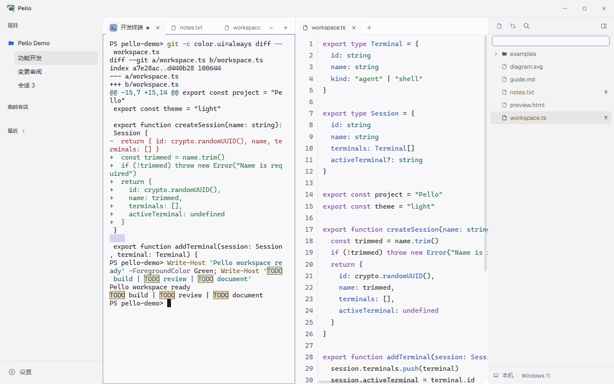

<h1 align="center">
  <picture>
    <source media="(prefers-color-scheme: dark)" srcset="assets/pello-logo-dark.svg">
    
  </picture>
</h1>

[简体中文](README.md) · **English**

**Run agents, edit files, and review changes in one workspace.**

Pello is a desktop workbench for coding agents on local and SSH projects. It organizes work by **Project → Session → Multiple Terminals and Tabs**, so you can run several agents, work on separate tasks, and review code changes in the same place.

[Download for Windows x64](https://github.com/FangYang970206/Pello/releases/latest) · [Illustrated guides (Chinese)](https://github.com/FangYang970206/Pello/wiki/Home) · [Changelog](CHANGELOG.md) · [Report an issue](https://github.com/FangYang970206/Pello/issues)



```text
Project (local or SSH directory, with pinning)
└── Session (per task, with renaming, history and native conversation resume)
    ├── Terminals (multiple agents or plain shells)
    ├── File tabs (source code, Markdown, HTML, PDFs, and images)
    └── Change tabs (unified and side-by-side Git diffs)
```

## Features

- **Switch between tasks without losing your place.** Keep multiple terminals and file tabs open in each session. Switching sessions preserves terminals and drafts. Create temporary sessions with their own local or SSH directories for one-off tasks.
- **Run multiple agents and resume conversations.** Use Claude Code, Codex, OpenCode, Pi, Oh My Pi, custom CLIs, or a plain shell. Pello uses the CLI and authentication already set up on the target machine. After a restart, it can restore terminal history and resume native conversations for supported agents.
- **Search logs and review code.** Search terminal output and highlight selected text in six colors. Review changes across nested repositories in unified or side-by-side Git diffs. In side-by-side mode, edit either side, scroll both panes together, and revert individual hunks. Edit source files and preview HTML drafts, PDFs, and images in tabs. Markdown supports outlines, diagrams, and zoom.
- **Manage MCP and skills.** View each agent's native resource configuration by machine. Inspect, enable, disable, and distribute resources to multiple targets. Open recommended skill repositories in your browser and import downloaded folders or ZIP files into the target agent.
- **Work locally or over SSH.** Open remote terminals, browse directories, edit files, and upload or download files. Pello includes six themes, English and Simplified Chinese, independent font sizes, and in-app updates.

## Getting started

1. Download the Windows x64 installer or ZIP, then install or extract and launch Pello.
2. Click the plus button beside **Projects** in the sidebar and choose a local or SSH project directory.
3. Click the plus button on the project row and pick an installed, authenticated agent CLI or **Shell only** to start your first session.

Visit the [Pello Wiki](https://github.com/FangYang970206/Pello/wiki/Home) for animated walkthroughs and step-by-step instructions in Chinese.
