

  <picture>
    <source media="(prefers-color-scheme: dark)" srcset="assets/pello-logo-dark.svg">
    
  </picture>

在同一个工作区，运行 Agent、编辑文件、审阅变更。

  <a href="https://github.com/FangYang970206/Pello/releases/latest">下载 Windows x64</a> ·
  <a href="https://github.com/FangYang970206/Pello/wiki">使用指南</a> ·
  <a href="CHANGELOG.md">更新记录</a> ·
  <a href="https://github.com/FangYang970206/Pello/issues">反馈问题</a>

## 开始使用

1. 下载 Windows 安装包或 ZIP，安装或解压后运行。
2. 点击左侧「项目」标题旁的 ＋，选择本机或 SSH 项目目录。
3. 点击项目行旁的 ＋，选择 Agent 或「仅 Shell」，启动会话。

Agent CLI 需提前安装并完成认证，Git 和 SSH 按需安装。

## 功能

动图会自动聚焦放大关键区域，点击可查看原图。也可[逐步查看静帧](assets/tutorials/STEPS.md)。

### 多 Agent

支持 Claude Code、Codex、OpenCode、Pi、Oh My Pi、自定义 CLI 与纯 Shell。[使用指南](https://github.com/FangYang970206/Pello/wiki/Executors)

[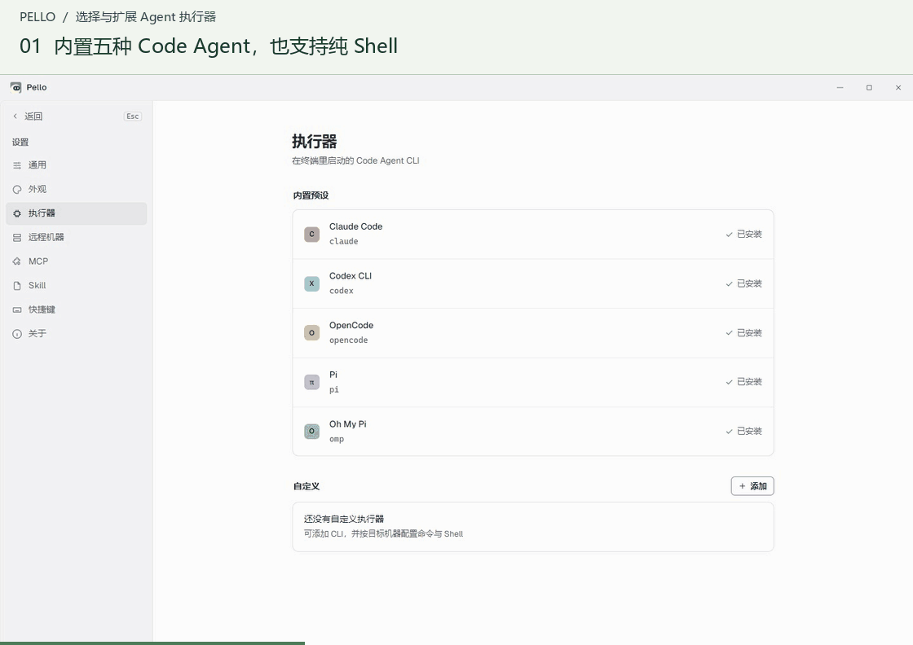](assets/tutorials/17-executors.gif)

### 会话管理

按项目组织多个会话与终端，支持置顶、重命名、历史恢复与 Agent 原生对话续接。[使用指南](https://github.com/FangYang970206/Pello/wiki/Sessions)

### 临时会话

为临时任务创建独立目录，支持本机与 SSH 环境。[使用指南](https://github.com/FangYang970206/Pello/wiki/Sessions)

### 混合分栏

终端、文件与 Diff 可自由组合，最多四栏，移动或合并时保留终端与草稿。[使用指南](https://github.com/FangYang970206/Pello/wiki/Split-Workspace)

### 终端搜索与高亮

Ctrl+F 查找输出，拖选后右键复制、粘贴或添加六色高亮。[使用指南](https://github.com/FangYang970206/Pello/wiki/Terminal)

[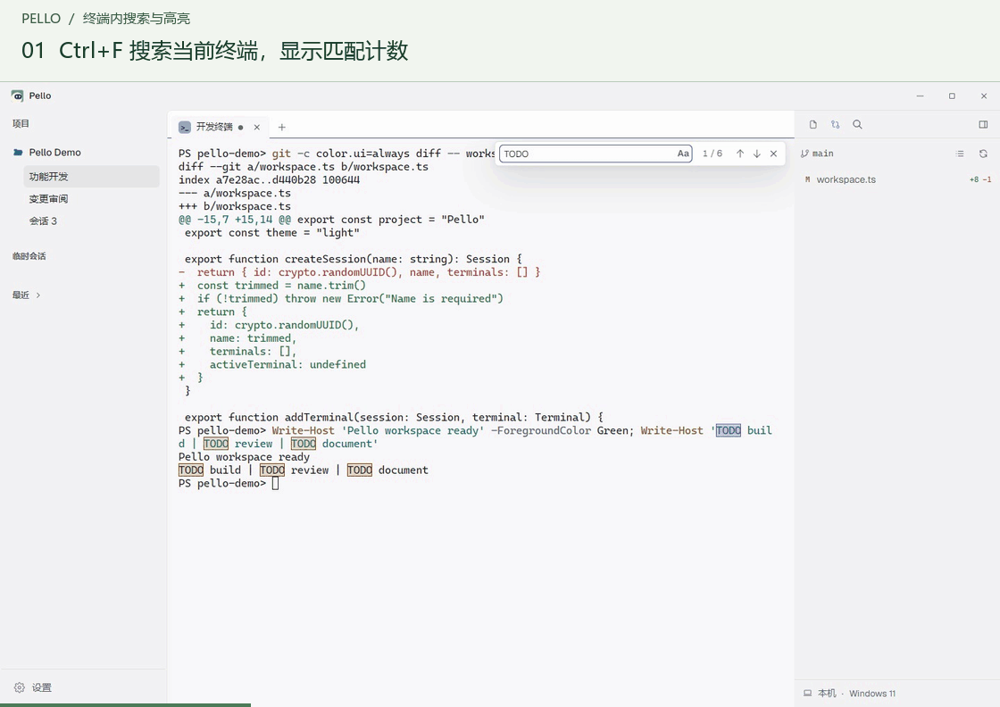](assets/tutorials/03-terminal.gif)

### 文件编辑

独立文件标签、源码高亮、草稿与撤销记录，支持手动及自动保存。[使用指南](https://github.com/FangYang970206/Pello/wiki/Files-and-Editing)

[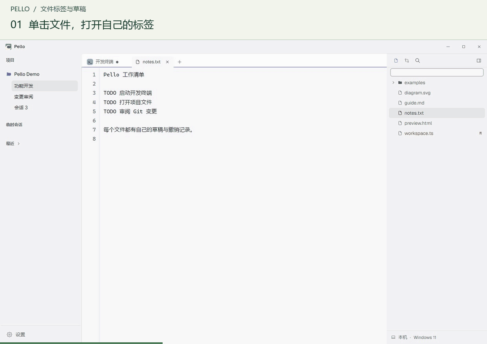](assets/tutorials/04-files.gif)

### 项目搜索

Ctrl+E 找文件，Ctrl+Shift+F 搜内容，点击结果直达源码。[使用指南](https://github.com/FangYang970206/Pello/wiki/Project-Search)

[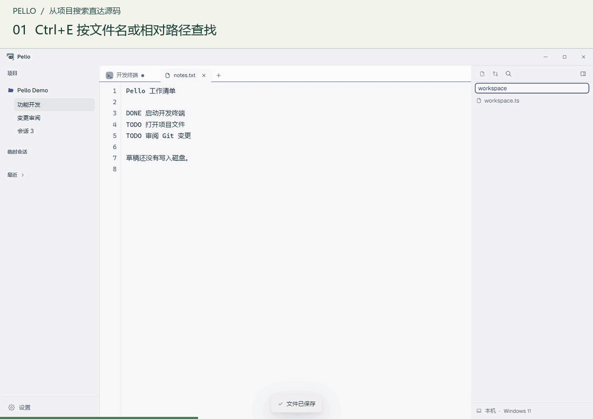](assets/tutorials/05-search.gif)

### 查找替换

Ctrl+F 查找，Ctrl+H 替换，自动定位匹配并保留撤销记录。[使用指南](https://github.com/FangYang970206/Pello/wiki/Find-and-Replace)

[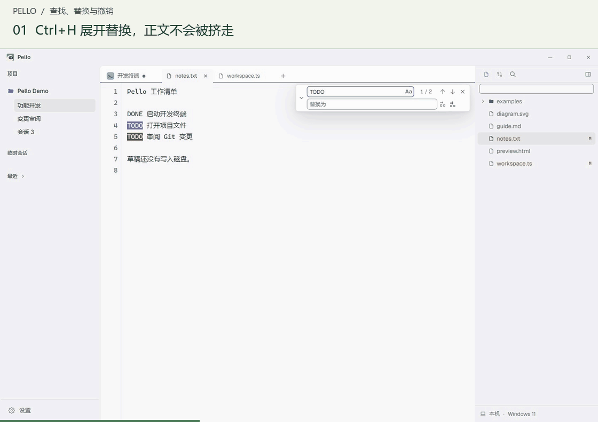](assets/tutorials/06-replace.gif)

### Markdown

直接阅读与编辑，支持标题目录、代码高亮、图表和局部缩放。[使用指南](https://github.com/FangYang970206/Pello/wiki/Markdown-and-HTML)

[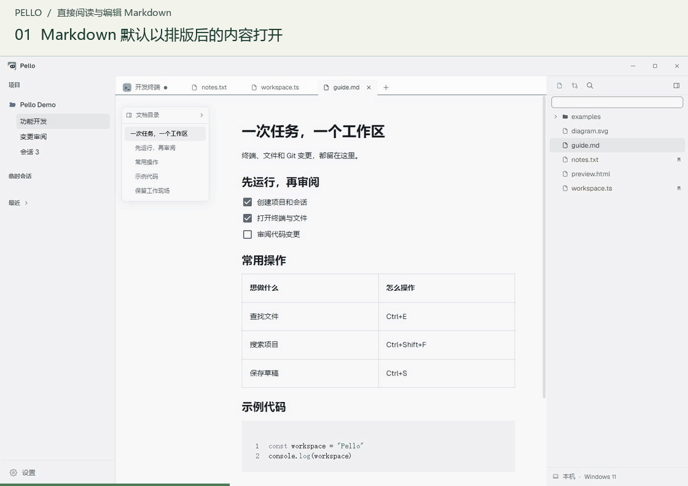](assets/tutorials/07-markdown.gif)

### HTML 预览

在源码与网页预览之间切换，直接查看当前草稿。[使用指南](https://github.com/FangYang970206/Pello/wiki/Markdown-and-HTML)

[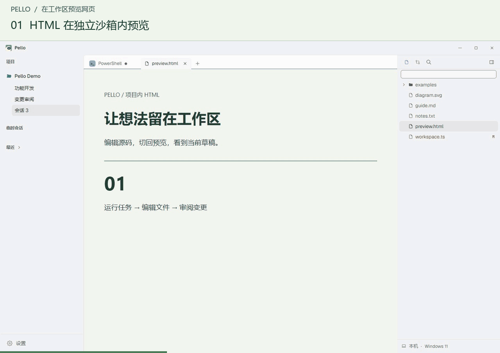](assets/tutorials/08-html.gif)

### PDF 与图片

在文件标签内预览，支持缩放、适应窗口、PDF 翻页与查找。[使用指南](https://github.com/FangYang970206/Pello/wiki/Media-Preview)

[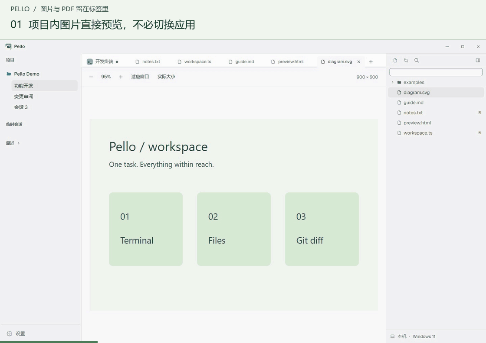](assets/tutorials/09-media.gif)

### Git 变更

统一与并排 Diff、双侧编辑、滚动联动和按块还原，支持子仓库。[使用指南](https://github.com/FangYang970206/Pello/wiki/Git-Review)

[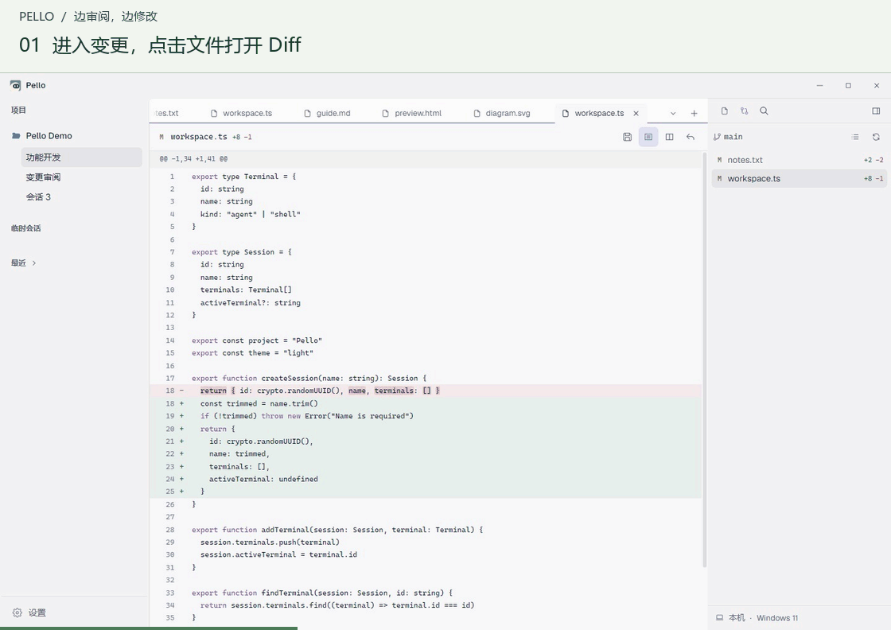](assets/tutorials/10-git.gif)

### SSH 远程项目

连接远程终端，浏览目录、编辑文件、上传和下载。[使用指南](https://github.com/FangYang970206/Pello/wiki/SSH-and-Transfer)

[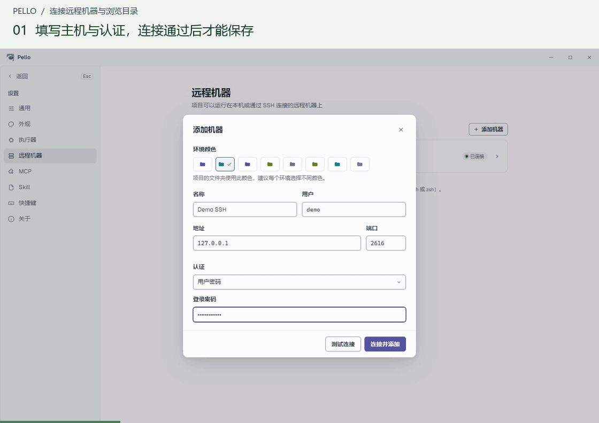](assets/tutorials/18-ssh.gif)

### MCP 与 Skill

按 Agent 查看原生资源配置，支持详情预览、启停与多目标分发。[使用指南](https://github.com/FangYang970206/Pello/wiki/Agent-Resources)

[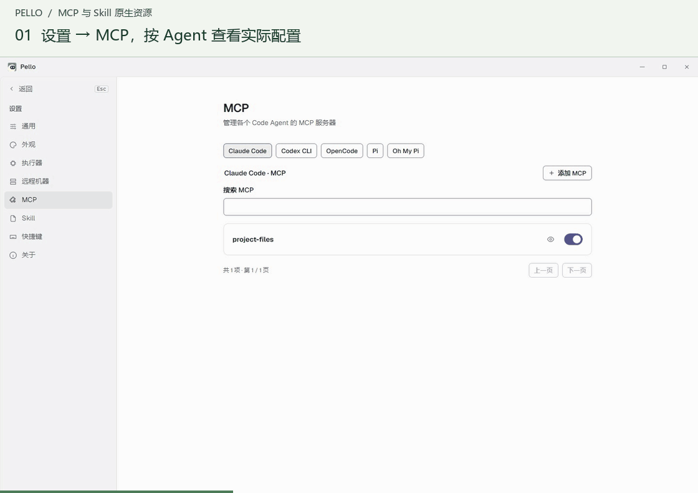](assets/tutorials/12-resources.gif)

### 推荐 Skill

在设置的 Skill 页打开推荐仓库。下载目录或 ZIP 后，可用“添加”导入到目标 Agent。[使用指南](https://github.com/FangYang970206/Pello/wiki/Skill-Discovery)

### 外观与语言

六套主题、简体中文与 English，终端、界面和源码字号独立设置。[使用指南](https://github.com/FangYang970206/Pello/wiki/Appearance)

### 应用更新

在「设置 → 通用 → 应用更新」检查、下载和安装新版本。[使用指南](https://github.com/FangYang970206/Pello/wiki/Updates-and-Data)

[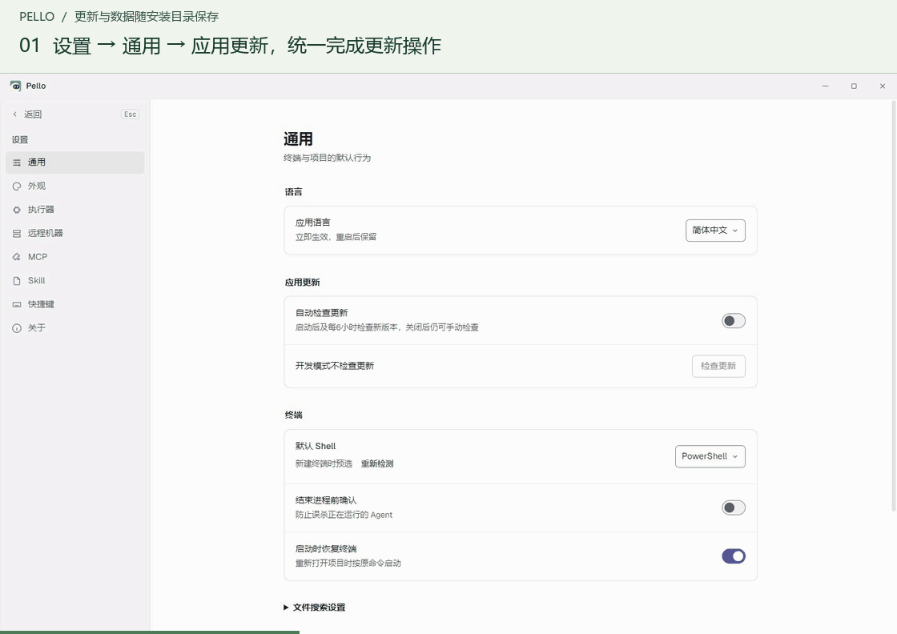](assets/tutorials/15-updates.gif)
