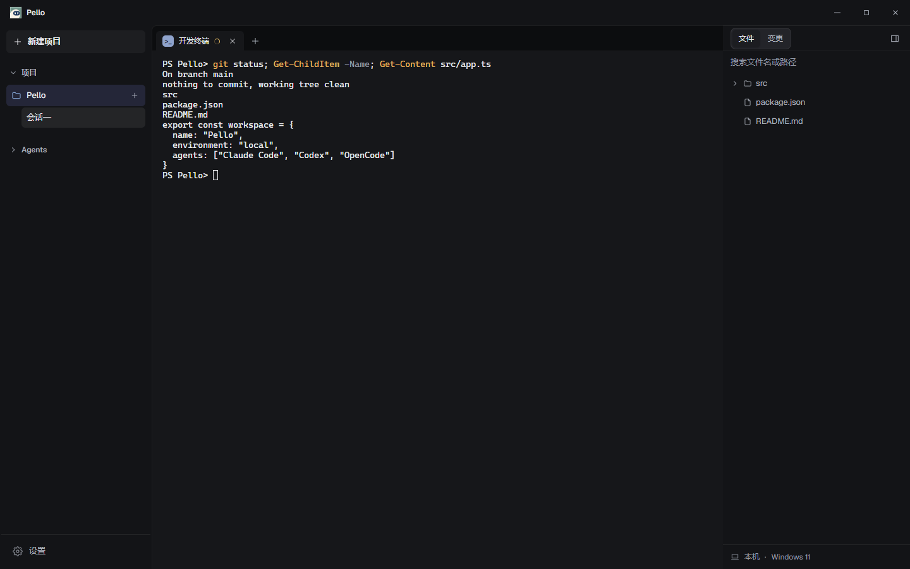

<p align="center">
  <picture>
    <source media="(prefers-color-scheme: dark)" srcset="assets/logo-horizontal-dark.svg">
    
  </picture>
</p>

<p align="center">让 Code Agent、终端与项目文件待在同一个工作区。</p>
<p align="center">
  <a href="https://github.com/FangYang970206/Pello/releases/latest">下载 Windows 版</a> ·
  <a href="https://github.com/FangYang970206/Pello/wiki">使用指南</a> ·
  <a href="CHANGELOG.md">更新记录</a> ·
  <a href="https://github.com/FangYang970206/Pello/issues">反馈问题</a>
</p>



## Pello 能做什么

- **集中管理 Agent**：Claude Code、OpenCode、Codex、Pi、Oh My Pi、自定义执行器及纯 Shell。
- **按项目组织工作**：多个会话、多个终端，本机与 SSH 远程环境随时切换。
- **就地处理文件**：文件树、Git 差异、Markdown 编辑、HTML 预览与远程传输。
- **统一管理资源**：发现、导入和分发各 Agent 的 MCP 与 Skill，支持主题和字体设置。

应用在本机运行，无需 Pello 账号或后端服务。Agent CLI 及其认证由你自行配置。

<details>
<summary>查看浅色界面</summary>


</details>

## 安装

从 [Releases](https://github.com/FangYang970206/Pello/releases/latest) 下载 Windows x64 安装包或 ZIP，安装或解压后运行。使用发行版无需 Node.js；Agent CLI、Git 与 SSH 按需安装。

添加项目，选择本机或远程目录，再通过项目旁的 **＋** 选择执行器开始工作。更多操作见 [Wiki](https://github.com/FangYang970206/Pello/wiki)。

## 开发

需要 Node.js 20.19+ 或 22.13+。Windows 原生终端模块编译需要 Python 3 和 Visual Studio Build Tools 2022（C++ 桌面开发）。

```powershell
git clone https://github.com/FangYang970206/Pello.git
cd Pello
npm install
npm run dev
```

提交前运行 `npm run verify`；Windows 打包运行 `npm run dist:win`。详见 [开发指南](https://github.com/FangYang970206/Pello/wiki/Development) 和 [打包指南](https://github.com/FangYang970206/Pello/wiki/Windows-Build)。
