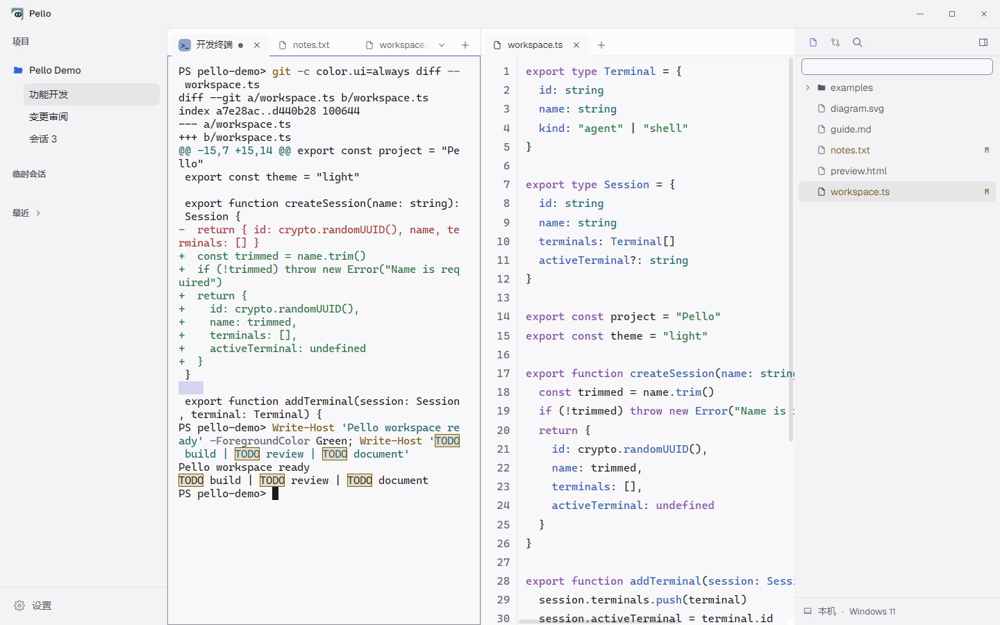
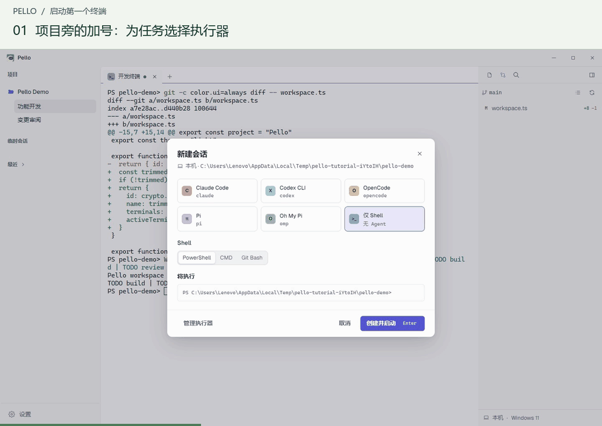
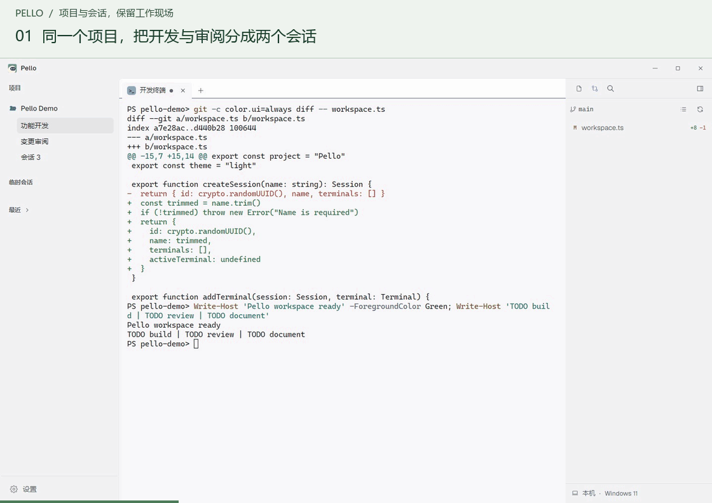
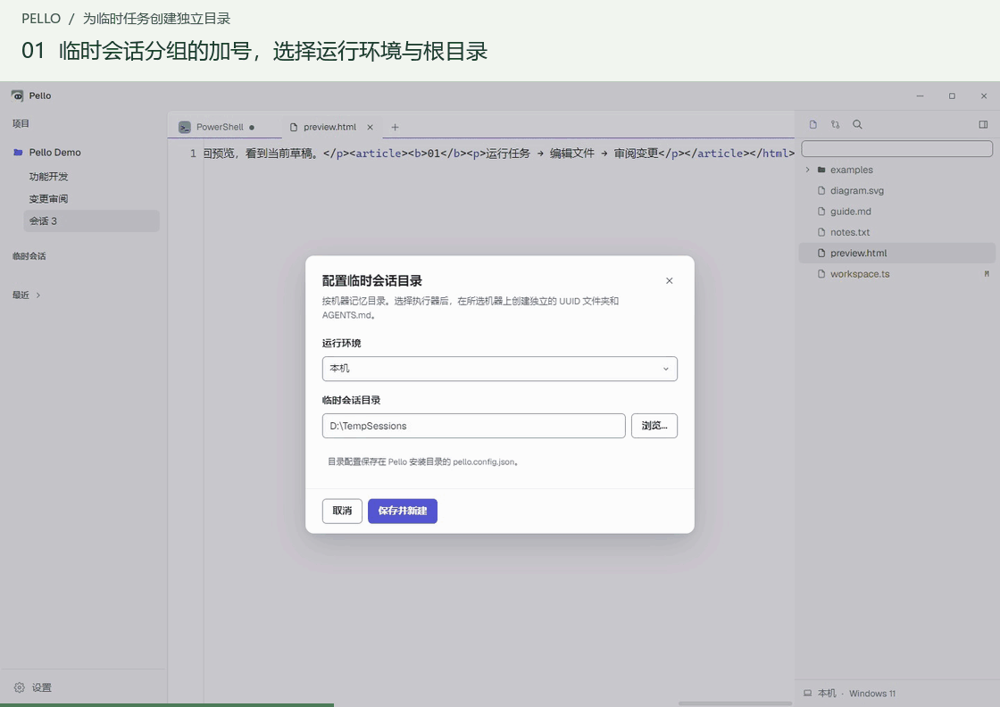
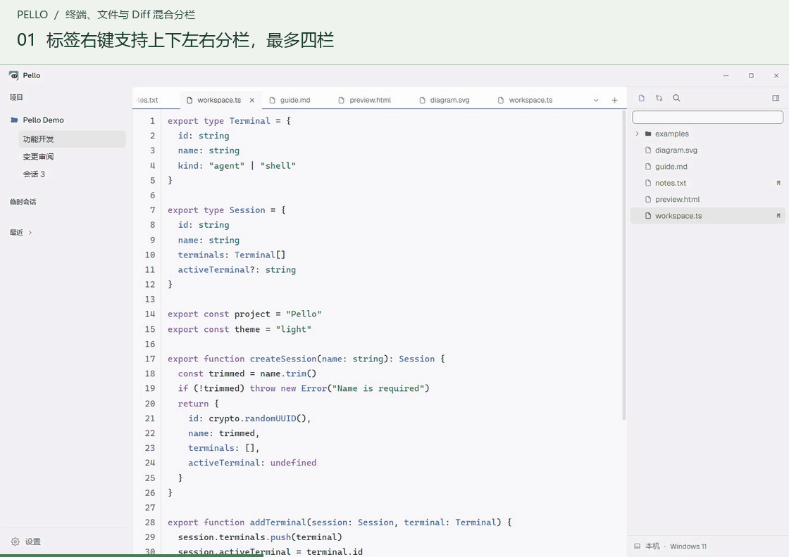
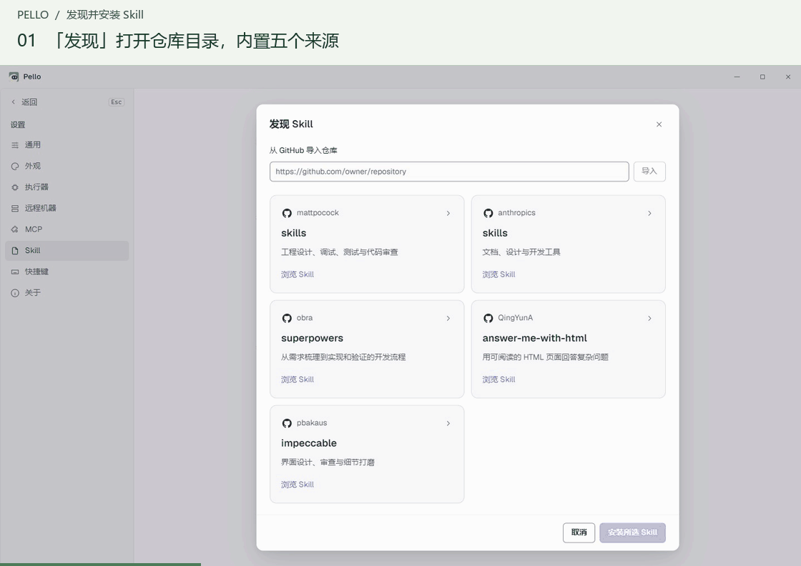
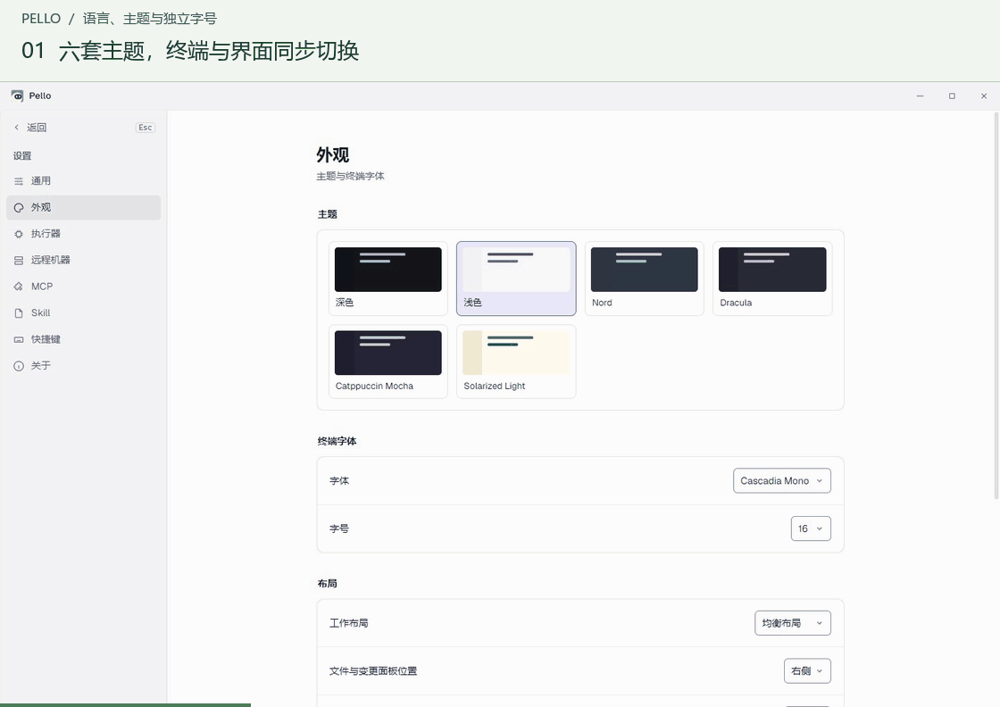

<p align="center">
  <picture>
    <source media="(prefers-color-scheme: dark)" srcset="assets/pello-logo-dark.svg">
    
  </picture>
</p>

<p align="center"><strong>从启动 Agent，到读文件、改代码、审阅变更。</strong><br>一个 Windows 桌面工作区，把任务需要的东西放在手边。</p>
<p align="center">
  <a href="https://github.com/FangYang970206/Pello/releases/latest">下载 Windows x64</a> ·
  <a href="https://github.com/FangYang970206/Pello/wiki">图解使用指南</a> ·
  <a href="CHANGELOG.md">更新记录</a> ·
  <a href="https://github.com/FangYang970206/Pello/issues">反馈问题</a>
</p>



Pello 管理你已安装的 Agent CLI、Shell 和项目文件。无需注册 Pello 账号；Agent 的安装、登录、模型服务与费用遵循各自的工具和服务。

## 三步开始

1. 从 [Releases](https://github.com/FangYang970206/Pello/releases/latest) 下载安装包或 ZIP，安装或解压后运行。发行版无需 Node.js。
2. 悬停左侧「项目」标题，点 ＋ 添加本机或 SSH 项目。
3. 点项目行的 ＋，选择 Agent 或「仅 Shell」，启动第一个会话。

[跟着动图开始 →](https://github.com/FangYang970206/Pello/wiki/Getting-Started)

## 看着操作，跟着上手

每段动图只讲一件事：先给出界面位置，再平滑放大到关键区域，停留阅读后进入下一步。**点击动图打开原尺寸**；想按自己的速度看，可打开[逐步静帧版](assets/tutorials/STEPS.md)。画面来自隔离示例项目中的实际操作，字幕与镜头聚焦在录制后添加。

| 开始任务 | 阅读与修改 | 审阅与远程 | 配置工具 |
| --- | --- | --- | --- |
| [执行器](#用你熟悉的-code-agent) · [会话](#让每个任务保留自己的现场) | [编辑](#文件各有标签编辑各有记录) · [搜索](#从项目里找直接到源码里看) | [Git](#看见变更再决定保留什么) · [SSH](#把远程项目带进同一个工作区) | [MCP / Skill](#mcp-与-skill按-agent-管理) |
| [临时会话](#临时想法也有独立工作目录) · [分栏](#终端文件和-diff并排放好) | [Markdown](#把-markdown-当文档读也当文档写) · [PDF / 图片](#需求图pdf-和代码放在一起) | [终端高亮](#在终端输出里找到关键线索) | [发现 Skill](#发现一个-skill读懂再安装) · [外观](#让界面适合你的阅读习惯) |

### 先启动一个终端

**选目录、选执行器，开始工作。** 悬停左侧「项目」标题点击 ＋ 添加项目，再点项目行的 ＋。第一次体验可选「仅 Shell」。

[](assets/tutorials/01-start.gif)

[操作指南 →](https://github.com/FangYang970206/Pello/wiki/Getting-Started) · [逐步看静帧](assets/tutorials/STEPS.md#01-start)

### 用你熟悉的 Code Agent

**Claude Code、Codex、OpenCode、Pi、Oh My Pi，也可以接入自己的 CLI。** 执行器沿用原生 CLI 与认证；在「设置 → 执行器」管理自定义命令、参数、Shell 和资源路径。

[](assets/tutorials/17-executors.gif)

[操作指南 →](https://github.com/FangYang970206/Pello/wiki/Executors) · [逐步看静帧](assets/tutorials/STEPS.md#17-executors)

### 让每个任务保留自己的现场

**一个项目，多个会话；一个会话，多个终端。** 在开发与审阅之间切换，终端继续保留。项目可置顶，项目、会话和标签可改名；重启后恢复历史并尝试续接各自的原生对话。

[](assets/tutorials/02-sessions.gif)

[操作指南 →](https://github.com/FangYang970206/Pello/wiki/Sessions) · [逐步看静帧](assets/tutorials/STEPS.md#02-sessions)

### 临时想法，也有独立工作目录

**不必先建正式项目，给一次小任务留一块空间。** 点「临时会话」旁的 ＋，选择本机或 SSH 环境与根目录。选好执行器后创建独立 UUID 目录和 AGENTS.md；取消不会创建任务子目录。

[](assets/tutorials/16-temporary.gif)

[操作指南 →](https://github.com/FangYang970206/Pello/wiki/Sessions) · [逐步看静帧](assets/tutorials/STEPS.md#16-temporary)

### 终端、文件和 Diff，并排放好

**四向分栏，最多四栏，每栏有自己的标签。** 标签右键选择分栏，拖动标签跨栏移动；合并会汇总标签。终端实例和文件草稿随操作保留，同一文件的独立视图共享草稿与撤销。

[](assets/tutorials/11-split.gif)

[操作指南 →](https://github.com/FangYang970206/Pello/wiki/Split-Workspace) · [逐步看静帧](assets/tutorials/STEPS.md#11-split)

### 在终端输出里找到关键线索

**查找、导航、拖选和六色高亮，都在当前终端完成。** Ctrl+F 搜索，Esc 返回终端；选中文字后右键选择高亮色。需要把鼠标交给 TUI 时，按住 Alt 再操作。

[](assets/tutorials/03-terminal.gif)

[操作指南 →](https://github.com/FangYang970206/Pello/wiki/Terminal) · [逐步看静帧](assets/tutorials/STEPS.md#03-terminal)

### 文件各有标签，编辑各有记录

**单击打开，切换回来继续编辑。** 源码高亮、草稿、撤销与重做、Ctrl+S 保存；自动保存默认防抖 2 分钟。保存会校验磁盘版本，外部改动冲突会明确报错。

[](assets/tutorials/04-files.gif)

[操作指南 →](https://github.com/FangYang970206/Pello/wiki/Files-and-Editing) · [逐步看静帧](assets/tutorials/STEPS.md#04-files)

### 从项目里找，直接到源码里看

**文件名搜索与全文搜索分开，各自保留查询。** Ctrl+E 搜索文件名或相对路径；Ctrl+Shift+F 搜索内容，可选大小写、全字和正则。点击片段定位源码，结果列表留在原处。

[](assets/tutorials/05-search.gif)

[操作指南 →](https://github.com/FangYang970206/Pello/wiki/Project-Search) · [逐步看静帧](assets/tutorials/STEPS.md#05-search)

### 找到它，改掉它，也能撤回来

**浮动搜索面板不挤占正文，匹配会自动滚到眼前。** Ctrl+F 查找，Ctrl+H 展开替换；Enter / Shift+Enter 和 F3 / Shift+F3 导航。替换进入草稿与撤销历史，Markdown 渲染模式同样可用。

[](assets/tutorials/06-replace.gif)

[操作指南 →](https://github.com/FangYang970206/Pello/wiki/Find-and-Replace) · [逐步看静帧](assets/tutorials/STEPS.md#06-replace)

### 把 Markdown 当文档读，也当文档写

**渲染、标题目录、代码高亮与文内查找，放在一起。** 默认打开渲染模式；正文右键切换源码。Ctrl+滚轮局部缩放，Mermaid 使用隔离沙箱渲染成图，PlantUML 会标明在线服务。

[](assets/tutorials/07-markdown.gif)

[操作指南 →](https://github.com/FangYang970206/Pello/wiki/Markdown-and-HTML) · [逐步看静帧](assets/tutorials/STEPS.md#07-markdown)

### 网页预览，不离开工作区

**项目里的 HTML 直接预览，相对资源路径继续可用。** 正文右键切源码，编辑后切回预览可查看当前草稿，无需先保存。预览在沙箱内，HTML 预览可查找，替换请切到源码。

[](assets/tutorials/08-html.gif)

[操作指南 →](https://github.com/FangYang970206/Pello/wiki/Markdown-and-HTML) · [逐步看静帧](assets/tutorials/STEPS.md#08-html)

### 需求图、PDF 和代码放在一起

**图片与 PDF 在文件标签内只读预览。** 适应窗口、实际大小与 25%–400% 缩放；PDF 支持页码、前后翻页与跨页查找。本机和 SSH 媒体文件均限制为 12 MB。

[](assets/tutorials/09-media.gif)

[操作指南 →](https://github.com/FangYang970206/Pello/wiki/Media-Preview) · [逐步看静帧](assets/tutorials/STEPS.md#09-media)

### 看见变更，再决定保留什么

**统一或并排 Diff，审阅时直接修改。** 并排两侧均可编辑、滚动联动，按差异块还原到工作区；比较基准的编辑不改写 Git 提交。支持子仓库发现、筛选及平铺/树状视图。

[](assets/tutorials/10-git.gif)

[操作指南 →](https://github.com/FangYang970206/Pello/wiki/Git-Review) · [逐步看静帧](assets/tutorials/STEPS.md#10-git)

### 把远程项目带进同一个工作区

**SSH 终端、目录浏览、文件编辑和传输一起使用。** 密钥、SSH Agent 或密码认证，通过连接验证后保存。浏览器式目录选择器可前进、返回、筛选；文件树菜单提供上传与下载。

[](assets/tutorials/18-ssh.gif)

[操作指南 →](https://github.com/FangYang970206/Pello/wiki/SSH-and-Transfer) · [逐步看静帧](assets/tutorials/STEPS.md#18-ssh)

### MCP 与 Skill，按 Agent 管理

**读取各 Agent 原生配置，查看详情、启停或按目标分发。** 设置中选择 Agent 后管理资源；新增 MCP 支持多目标，Skill 可导入本机目录或 ZIP。同名资源不覆盖，认证值在详情中脱敏。

[](assets/tutorials/12-resources.gif)

[操作指南 →](https://github.com/FangYang970206/Pello/wiki/Agent-Resources) · [逐步看静帧](assets/tutorials/STEPS.md#12-resources)

### 发现一个 Skill，读懂再安装

**仓库、搜索、说明预览、选择目标，一条路线走完。** 「设置 → Skill → 发现」提供五个内置仓库，也接受 GitHub HTTPS 仓库或 tree 链接。可选部分或全部 Skill，扫描与安装复用固定提交快照。

[](assets/tutorials/13-discovery.gif)

[操作指南 →](https://github.com/FangYang970206/Pello/wiki/Skill-Discovery) · [逐步看静帧](assets/tutorials/STEPS.md#13-discovery)

### 让界面适合你的阅读习惯

**六套主题，简体中文 / English，分别设置字体与字号。** 终端、界面和源码字号独立保存，Diff 沿用终端设置；语言与主题即时生效。编辑器 Ctrl+滚轮局部缩放不会改动全局字号。

[](assets/tutorials/14-appearance.gif)

[操作指南 →](https://github.com/FangYang970206/Pello/wiki/Appearance) · [逐步看静帧](assets/tutorials/STEPS.md#14-appearance)

### 更新入口集中，工作数据随安装目录保存

**检查、下载、重试和安装重启，都在通用设置。** 自动检查默认开启，可关闭，仍能手动检查。配置、会话历史、缓存与日志在安装目录 data 下；升级与卸载保留 data 和 pello.config.json。

[](assets/tutorials/15-updates.gif)

[操作指南 →](https://github.com/FangYang970206/Pello/wiki/Updates-and-Data) · [逐步看静帧](assets/tutorials/STEPS.md#15-updates)

## 安装、数据与更新

发行版目前提供 **Windows x64** 安装包与 ZIP。Agent CLI、Git 和 SSH 按需提前安装；SSH 项目需要在远端安装相应 CLI。安装目录须允许当前用户写入。

Pello 的配置、会话历史、缓存、日志和更新下载保存在安装目录 `data/`，`pello.config.json` 位于安装目录根部。首次启动会完整复制迁移旧版 `%APPDATA%\agent-workbench`，保留旧目录，不覆盖已有安装数据。升级和卸载保留 `data/` 与 `pello.config.json`；安装版可通过 Windows 应用列表或 `Uninstall Pello.exe` 卸载。

[更新与备份指南](https://github.com/FangYang970206/Pello/wiki/Updates-and-Data) · [遇到问题](https://github.com/FangYang970206/Pello/wiki/Troubleshooting)

## 从源码开发

需要 Node.js 20.19+ 或 22.13+；Windows 原生终端模块编译需要 Python 3 与 Visual Studio Build Tools 2022（C++ 桌面开发）。

```powershell
git clone https://github.com/FangYang970206/Pello.git
cd Pello
npm install
npm run dev
```

日常改动运行 `npm run lint`、`npm run typecheck` 和受影响的定向行为用例；发布前运行 `npm run verify` 与必要的深度验证。Windows 打包运行 `npm run dist:win`。

[开发与验证](https://github.com/FangYang970206/Pello/wiki/Development) · [Windows 打包](https://github.com/FangYang970206/Pello/wiki/Windows-Build) · [文档与动图维护](assets/tutorials/README.md)

Apache-2.0 · 作者 [方阳 / FangYang](https://github.com/FangYang970206)

介绍形式参考 [WindTerm 的功能目录](https://github.com/kingToolbox/WindTerm#features)与[独立操作教程](https://kingtoolbox.github.io/2020/01/22/new-session/)，文案、画面和动图均为 Pello 制作。
