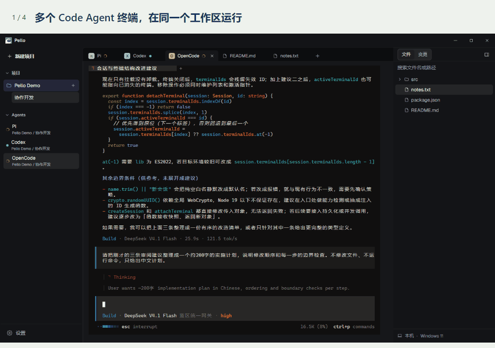
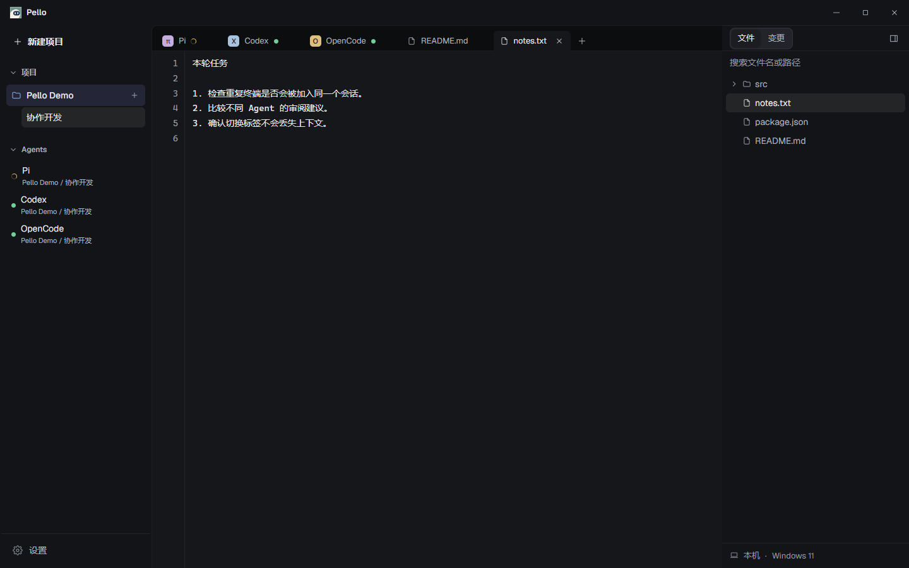
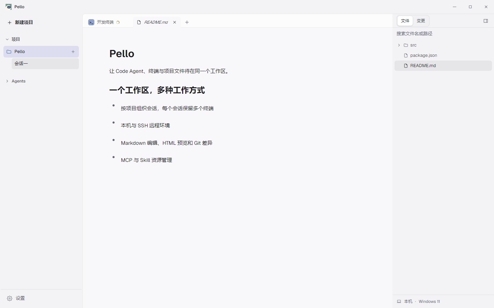
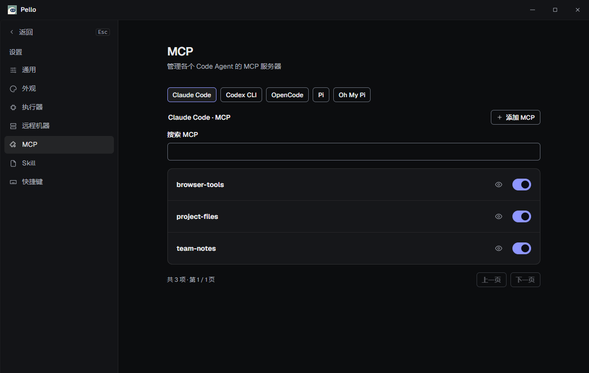

<p align="center">
  <picture>
    <source media="(prefers-color-scheme: dark)" srcset="assets/logo-horizontal-dark.svg">
    
  </picture>
</p>

<p align="center">在同一个工作区，运行 Agent、编辑文件、审阅变更。</p>
<p align="center">
  <a href="https://github.com/FangYang970206/Pello/releases/latest">下载 Windows 版</a> ·
  <a href="https://github.com/FangYang970206/Pello/wiki">使用指南</a> ·
  <a href="CHANGELOG.md">更新记录</a> ·
  <a href="https://github.com/FangYang970206/Pello/issues">反馈问题</a>
</p>


<p align="center"><sub>Pi 与 OpenCode 正在处理示例任务，Codex 等待输入。多个 Agent 终端与普通文件，共用一个工作区。</sub></p>

| 你的工作 | 在 Pello 里 |
| --- | --- |
| 运行 Agent | [本机或 SSH 项目，多会话、多终端](https://github.com/FangYang970206/Pello/wiki/Getting-Started) |
| 处理项目文件 | [Git 差异、Markdown 编辑、HTML 预览](https://github.com/FangYang970206/Pello/wiki/Workspace) |
| 配好 Agent 资源 | [原生 MCP / Skill 的发现、导入与分发](https://github.com/FangYang970206/Pello/wiki/Agent-Resources) |

支持 Claude Code、OpenCode、Codex、Pi、Oh My Pi、自定义执行器及纯 Shell。应用在本机运行，无需 Pello 账号；Agent CLI 及其认证自行配置。

<details>
<summary>看 10 秒日常工作流</summary>

查看 OpenCode → 切到 Pi → 打开普通文件 → 回到 Agent。以下演示来自实际应用，使用独立示例项目。



[查看 OpenCode 运行图](assets/screenshots/codeagents-running.png) · [查看 Pi 运行图](assets/screenshots/codeagents-pi.png)

</details>

<details>
<summary>更多界面：普通文件、Markdown 与 MCP</summary>

**打开普通文件，Agent 终端仍保留在标签栏**



**在工作区编辑 Markdown**



**按 Agent 管理 MCP**



</details>

## 安装

从 [Releases](https://github.com/FangYang970206/Pello/releases/latest) 下载 Windows x64 安装包或 ZIP，安装或解压后运行。使用发行版无需 Node.js；Agent CLI、Git 与 SSH 按需安装。

第一次使用，跟着 [三个步骤启动终端](https://github.com/FangYang970206/Pello/wiki/Getting-Started)。

<details>
<summary>从源码开发</summary>

需要 Node.js 20.19+ 或 22.13+。Windows 原生终端模块编译需要 Python 3 和 Visual Studio Build Tools 2022（C++ 桌面开发）。

```powershell
git clone https://github.com/FangYang970206/Pello.git
cd Pello
npm install
npm run dev
```

提交前运行 `npm run verify`；Windows 打包运行 `npm run dist:win`。详见 [开发指南](https://github.com/FangYang970206/Pello/wiki/Development) 和 [打包指南](https://github.com/FangYang970206/Pello/wiki/Windows-Build)。

</details>
