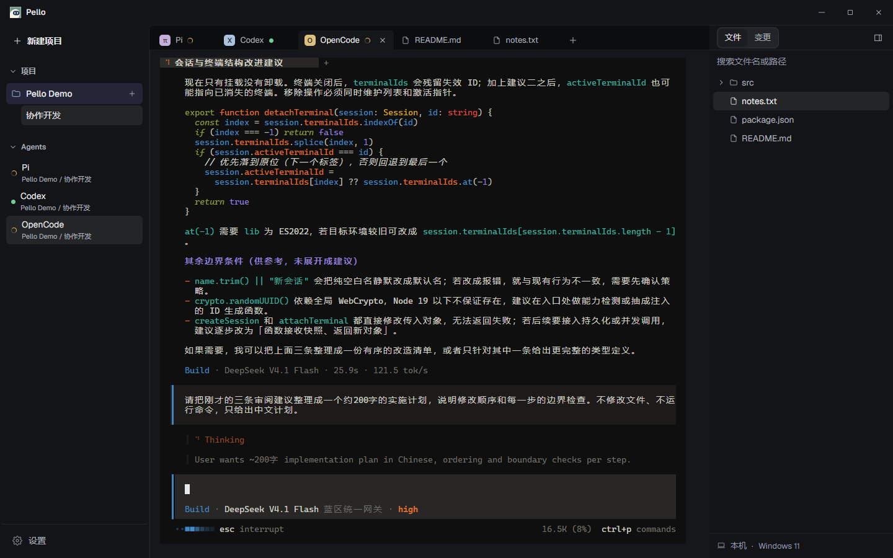

<p align="center">
  <picture>
    <source media="(prefers-color-scheme: dark)" srcset="assets/pello-logo-dark.svg">
    
  </picture>
</p>

<p align="center">在同一个工作区，运行 Agent、编辑文件、审阅变更。</p>
<p align="center">
  <a href="https://github.com/FangYang970206/Pello/releases/latest">下载 Windows 版</a> ·
  <a href="https://github.com/FangYang970206/Pello/wiki">使用指南</a> ·
  <a href="CHANGELOG.md">更新记录</a> ·
  <a href="https://github.com/FangYang970206/Pello/issues">反馈问题</a>
</p>



## 安装

从 [Releases](https://github.com/FangYang970206/Pello/releases/latest) 下载 Windows x64 安装包或 ZIP，安装或解压后运行。使用发行版无需 Node.js；Agent CLI、Git 与 SSH 按需安装。

第一次使用，跟着 [三个步骤启动终端](https://github.com/FangYang970206/Pello/wiki/Getting-Started)。

Pello 自身的配置、会话历史、缓存、日志及更新下载保存在安装目录的 `data` 文件夹，`pello.config.json` 位于安装目录根部。首次启动会复制迁移旧版 `%APPDATA%\agent-workbench`，并保留旧目录；安装位置须允许当前用户写入。

更新操作统一位于“设置 → 通用 → 应用更新”。自动检测默认开启，可关闭并在重启后保留，关闭后仍可手动检查。检测到新版本时显示版本号和下载按钮，下载进度、失败重试及安装重启均在同一栏目完成。安装版在安装目录提供 `Uninstall Pello.exe`，也可通过 Windows 应用列表卸载；升级和卸载保留数据。ZIP 解压版可直接删除程序文件，按需保留 `data` 与 `pello.config.json`。发布更新时需将构建生成的 `latest.yml`、安装包及 `.blockmap` 一起上传到 GitHub Release。

<details>
<summary>从源码开发</summary>

需要 Node.js 20.19+ 或 22.13+。Windows 原生终端模块编译需要 Python 3 和 Visual Studio Build Tools 2022（C++ 桌面开发）。

```powershell
git clone https://github.com/FangYang970206/Pello.git
cd Pello
npm install
npm run dev
```

提交前运行 `npm run verify`；Windows 打包运行 `npm run dist:win`。详见 [开发指南](https://github.com/FangYang970206/Pello/wiki/Development) 和 [打包指南](https://github.com/FangYang970206/Pello/wiki/Windows-Build)。

</details>
