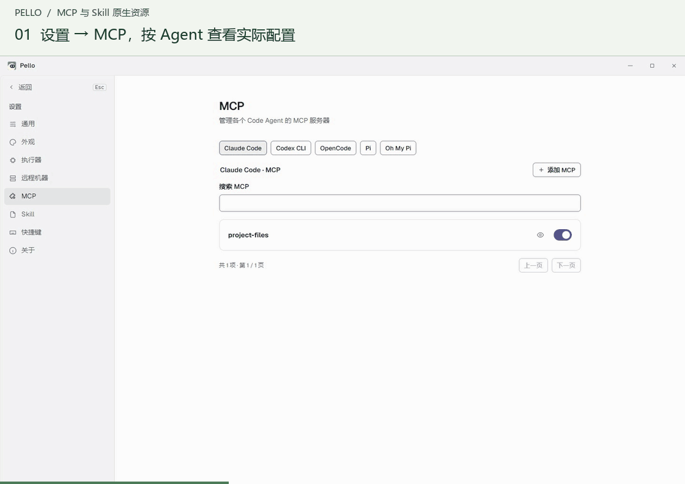

# MCP 与 Skill，用原生配置管理

按 Agent 查看资源，再选择要分发的目标。

[逐步看静帧](https://github.com/FangYang970206/Pello/blob/main/assets/tutorials/STEPS.md#12-resources) · [打开原尺寸动图](https://raw.githubusercontent.com/FangYang970206/Pello/main/assets/tutorials/12-resources.gif)

## 管理 MCP

1. 「设置 → MCP」选择目标 Agent。
2. 查看现有服务器，点眼睛看命令、地址和参数；认证值脱敏。
3. 点添加，在模态窗口填写配置，选择一个或多个 Agent，提交后查看逐项结果。

修改会备份并尽量保留原生 TOML / JSONC / JSON 中不相关字段与注释；同名资源不覆盖。失败目标和输入保留在窗口内。导入成功不代表 MCP 服务已运行或 OAuth 已完成。

## 管理 Skill

「设置 → Skill」按 Agent 查看发现目录里的 Skill。眼睛打开完整说明；开关按 Agent 实际机制启停。更多菜单可打开实际目录，或确认后移入系统回收站。

添加支持本机目录或 ZIP。可从设置中的[推荐 Skill](Skill-Discovery)打开仓库并查阅各项目说明。导入检查 `SKILL.md`、真实路径、解压大小与数量，不执行导入内容。

## 开关与共享目录

开关状态来自 Agent 实际配置，不是 Pello 自己维护一个无效的 enabled 值。关闭会保留可恢复配置；恢复遇到同名新配置会拒绝覆盖。共享目录可能影响多个 Agent，删除确认会说明，工作台不会递归删除共享链接目标。

**完成标志**：刷新列表能看到资源，并在相应 Agent 原生界面重新加载或新开会话后找到它。

动图中的 MCP 为示例配置，没有启动对应服务器；Skill 则来自隔离演示目录。

[功能目录](Home) · [日常工作路线](Workspace)
