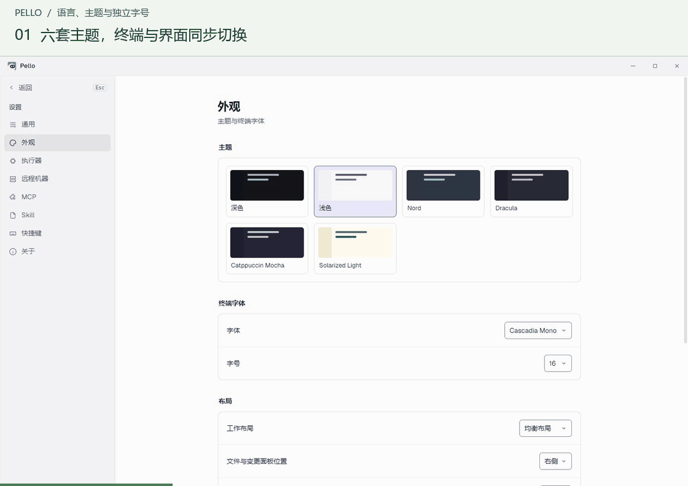

# 按你的习惯阅读与工作

主题、语言和字号独立设置，切换时保留终端与草稿。

[逐步看静帧](https://github.com/FangYang970206/Pello/blob/main/assets/tutorials/STEPS.md#14-appearance) · [打开原尺寸动图](https://raw.githubusercontent.com/FangYang970206/Pello/main/assets/tutorials/14-appearance.gif)

## 外观

「设置 → 外观」有深色、浅色、Nord、Dracula、Catppuccin Mocha 与 Solarized Light 六套主题。新配置默认浅色，已有选择保留。终端 ANSI 色板跟随界面；Agent 自己的真彩色主题仍由 Agent 控制。

终端、界面、源码字号分别保存。Diff 字体与字号沿用终端。随包提供 JetBrains Mono、Fira Code、IBM Plex Mono 与中文字体回退；切换字体会重新适配终端尺寸，不重新启动进程。

## 语言

「设置 → 通用 → 应用语言」选择简体中文或 English，立即生效并在重启后保留。应用自有菜单、弹窗与错误翻译；文件内容、用户名称、路径及 Agent 输出保持原样。

## 只想临时放大当前内容

| 内容 | 操作 | 范围 |
| --- | --- | --- |
| 源码、Markdown、HTML、统一/并排 Diff | Ctrl+滚轮 | 50%–300% |
| 图片与 PDF | 预览工具栏 / Ctrl+滚轮 | 25%–400% |

局部缩放不修改全局字号，也不清空草稿或撤销。文件面板与项目侧栏可拖宽；分栏后的每栏按实际空间布局。

[功能目录](Home) · [日常工作路线](Workspace)
