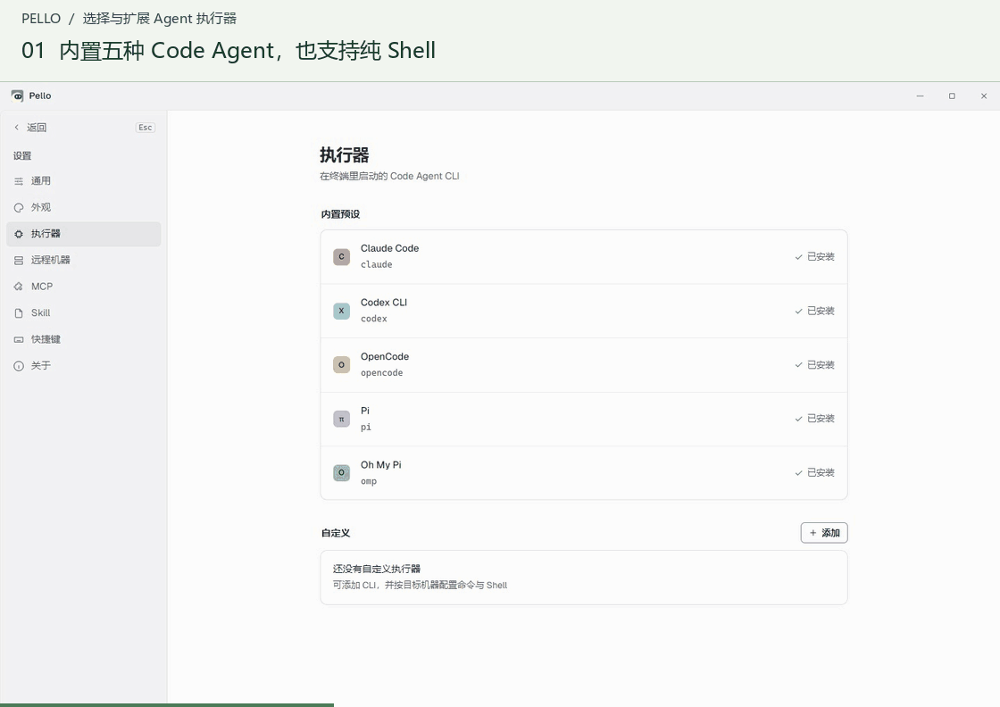

# 使用原生 Agent，也接入自己的 CLI

执行器告诉 Pello 在哪台机器、用哪个 Shell 和命令启动工具。

[逐步看静帧](https://github.com/FangYang970206/Pello/blob/main/assets/tutorials/STEPS.md#17-executors) · [打开原尺寸动图](https://raw.githubusercontent.com/FangYang970206/Pello/main/assets/tutorials/17-executors.gif)

## 内置选择

Claude Code、Codex、OpenCode、Pi、Oh My Pi、自定义执行器与仅 Shell。实际终端运行原生 CLI，输出与工具交互保持原样。SSH 项目在远端启动工具，不能只在本机安装 CLI。

## 添加自定义 CLI

1. 进入「设置 → 执行器」，在「自定义」区域点击「添加」。
2. 填写名称、命令、参数和 Shell。先在目标机器的普通终端核对命令可执行。
3. 可以按机器配置命令与 Shell；用测试按钮检查退出码与输出。保存失败时输入会保留。
4. 展开高级属性，按工具需要设置 MCP 文件、格式和 Skill 目录；路径使用绝对路径。

**你应该看到**：新建会话时能选择刚保存的执行器。

## 原生会话恢复

内置工具使用各自的原生恢复能力。自定义执行器只有在 CLI 支持指定会话 ID 时才应开启恢复，并填写新建/恢复参数，使用 `{sessionId}` 占位。不要把普通命令误配为支持对话恢复的 Agent。

资源映射的格式、发现目录和启停能力取决于 Agent 的原生机制。修改资源后按该工具要求重新加载或新开会话。

[功能目录](Home) · [日常工作路线](Workspace)
