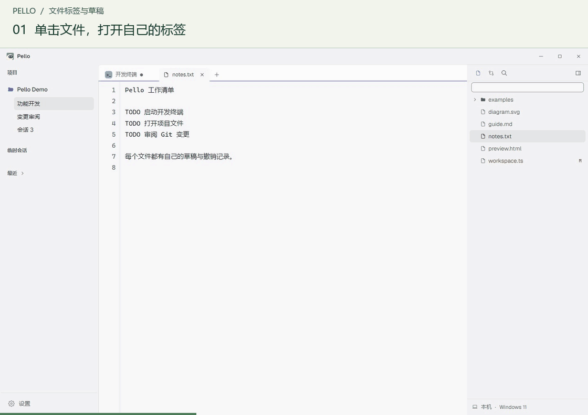

# 文件标签、草稿与可靠保存

单击打开自己的标签，切换回来继续写。

[逐步看静帧](https://github.com/FangYang970206/Pello/blob/main/assets/tutorials/STEPS.md#04-files) · [打开原尺寸动图](https://raw.githubusercontent.com/FangYang970206/Pello/main/assets/tutorials/04-files.gif)

## 跟着做

1. 在文件面板单击文件。再次点击同一文件会定位到当前栏已有标签。
2. 修改内容，观察未保存标记。切换文件后再回来，草稿仍在。
3. Ctrl+S 保存，Ctrl+Z / Ctrl+Shift+Z 撤销与重做；保存后仍可撤销。

草稿、撤销和重做属于文件。同一文件在多栏打开会共享编辑状态。默认自动保存按文件防抖 2 分钟；输入法组合、放弃确认与保存失败时暂停。

## 新建、重命名与路径

文件树目录或空白处右键创建文件/文件夹；文件树条目右键提供重命名、移动、删除、复制路径和打开方式。项目菜单里的改名只改项目显示名，真实文件变更在文件树内完成。

## 保存时检查什么

保存经主进程验证真实项目边界、链接、UTF-8、大小与磁盘版本，并原子替换；保留 BOM 与换行。若其他工具已改过同一文件，先保留草稿并比较外部版本，不能直接覆盖冲突。非 UTF-8 或超过 2 MB 的文本不作为普通可编辑文本处理。媒体预览另有 12 MB 上限。

[项目内容搜索](Project-Search) · [文档查找替换](Find-and-Replace) · [媒体预览](Media-Preview)

[功能目录](Home) · [日常工作路线](Workspace)
