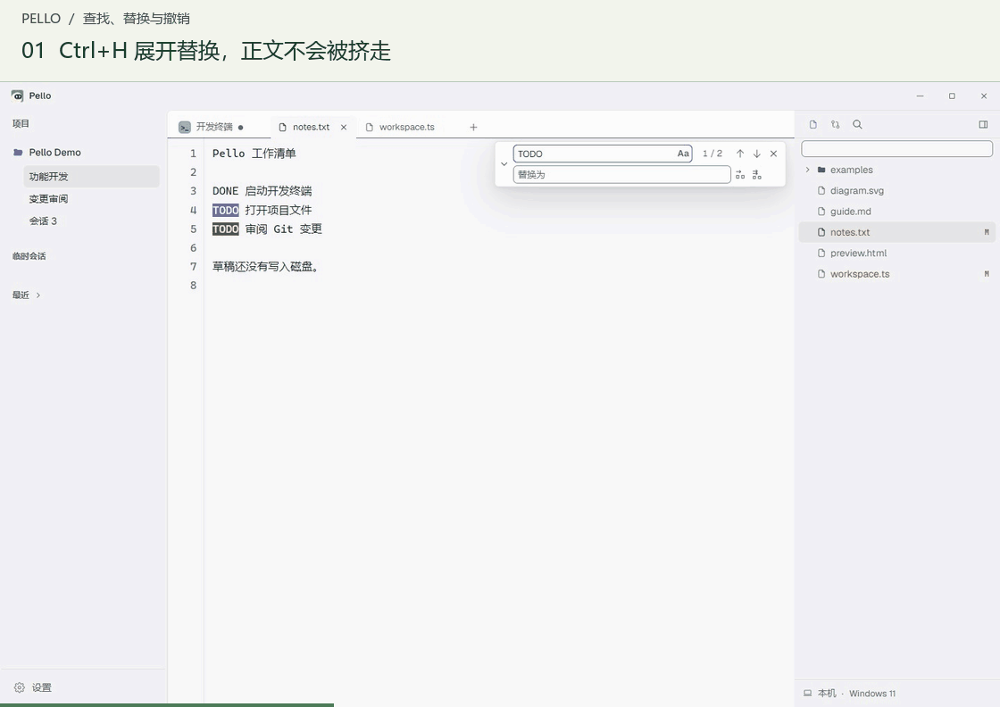

# 不离开正文，完成查找与替换

搜索面板浮在内容区右上角，打开时不挤走正文。

[逐步看静帧](https://github.com/FangYang970206/Pello/blob/main/assets/tutorials/STEPS.md#06-replace) · [打开原尺寸动图](https://raw.githubusercontent.com/FangYang970206/Pello/main/assets/tutorials/06-replace.gif)

## 跟着做

1. 点击目标文件或 Diff，按 **Ctrl+F** 输入文字，匹配会自动滚到可见位置。
2. Enter / Shift+Enter 或 F3 / Shift+F3 前后导航；可切换大小写。
3. **Ctrl+H** 展开替换，填写替换文字，执行单处或全部替换。
4. Esc 关闭并回到内容；Ctrl+Z 可撤销替换。需要落盘时 Ctrl+S。

替换文字按字面处理，例如 `$&` 就是这两个字符，不作为特殊替换指令。

## 各内容支持什么

| 内容 | 查找 | 替换 |
| --- | --- | --- |
| 普通源码 | 匹配计数、导航、自动定位 | 单处/全部，进入草稿与撤销 |
| Markdown 渲染 | 在文档模型中定位，包含代码块 | 保持格式，不切换源码 |
| HTML 预览 | 沙箱内查找 | 切到源码后替换 |
| PDF | 跨页查找并标记匹配 | 只读 |
| Git Diff | 选择工作区或比较基准 | 只修改选定一侧，基准编辑不改写 Git 提交 |
| 图片 | 不提供文字搜索 | 只读 |

终端有[独立的搜索](Terminal)。设置、弹窗和输入法组合期间不会误接管文档快捷键。

[功能目录](Home) · [日常工作路线](Workspace)
