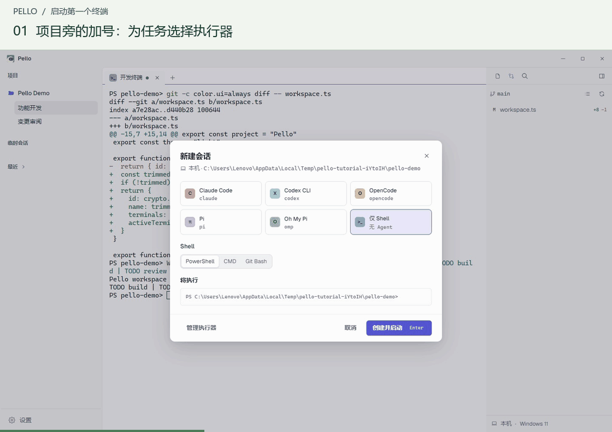

# 五分钟，启动第一个终端

先用 Shell 跑通一次，再换成你日常使用的 Agent。

[逐步看静帧](https://github.com/FangYang970206/Pello/blob/main/assets/tutorials/STEPS.md#01-start) · [打开原尺寸动图](https://raw.githubusercontent.com/FangYang970206/Pello/main/assets/tutorials/01-start.gif)

## 先准备

下载 [Windows x64 安装包或 ZIP](https://github.com/FangYang970206/Pello/releases/latest)。安装或解压后运行，发行版无需 Node.js。选择可写的安装目录。

## 跟着做

1. 把鼠标移到左侧「项目」标题，点右侧的 **＋**。填写名称，选择本机目录；也可以选择已配置的 SSH 机器。
2. 保存后，把鼠标移到项目行，点 **＋**。这是新建会话的入口。
3. 选择 **仅 Shell** 与可用的 Shell，点击启动。在终端输入 `echo Hello Pello`。

**你应该看到**：左侧出现会话，中间出现终端标签，并输出 `Hello Pello`。

## 换成 Agent

Agent CLI 要事先安装在运行它的环境中，并完成原生认证。项目行的 ＋ 新建一个会话，选择 Claude Code、Codex、OpenCode、Pi 或 Oh My Pi。自定义 CLI 见[执行器](Executors)。Pello 不代替 Agent 登录，也不提供模型额度。

## 两个加号有什么区别

| 入口 | 创建什么 |
| --- | --- |
| 项目标题旁 ＋ | 项目记录 |
| 项目行旁 ＋ | 当前项目的新会话及首个终端 |
| 当前栏标签旁 ＋ | 当前会话里的新终端 |
| 临时会话标题旁 ＋ | 带独立工作目录的临时任务 |

项目标题和项目行的加号在悬停或键盘聚焦时显示。快捷键可在「设置 → 快捷键」查看。

[功能目录](Home) · [日常工作路线](Workspace)
