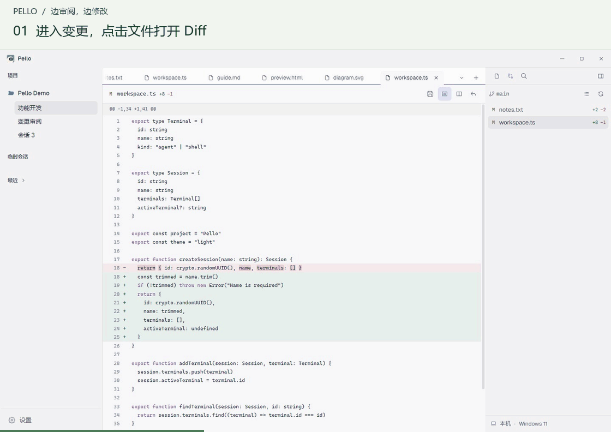

# 看见代码变化，再决定如何修改

Git 变更列表与可编辑 Diff 放在同一个工作区。

[逐步看静帧](https://github.com/FangYang970206/Pello/blob/main/assets/tutorials/STEPS.md#10-git) · [打开原尺寸动图](https://raw.githubusercontent.com/FangYang970206/Pello/main/assets/tutorials/10-git.gif)

## 跟着做

1. 点击文件面板的「变更」图标，再点击变更文件。
2. 用 Diff 顶部图标切换统一/并排视图，悬停可查看提示。
3. 并排模式左边为比较基准、右边为工作区，两边都可编辑，横纵滚动联动。
4. 使用中间的块级双箭头，把该块从基准还原到工作区。Ctrl+S 保存工作区文件。

**你应该看到**：工作区草稿随修改更新，基准侧的编辑不会改写 Git 提交。放弃更改会走确认与版本校验，不绕过外部冲突。

## 多仓库与大列表

后台发现子仓库，可筛选、重新扫描并查看错误。列表顶部显示分支或仓库数，右侧同一个视图按钮切换平铺/树状，再右侧是刷新；树状目录可折叠。文件始终用完整项目相对路径打开 Diff。

两种列表均虚拟渲染并可键盘导航。并排分隔线支持鼠标拖动与键盘调整；字体和字号跟随终端设置，局部 Ctrl+滚轮缩放会同步两侧和行号。

这里只负责审阅与编辑。提交、分支等 Git 命令可以在项目终端中执行。

[功能目录](Home) · [日常工作路线](Workspace)
