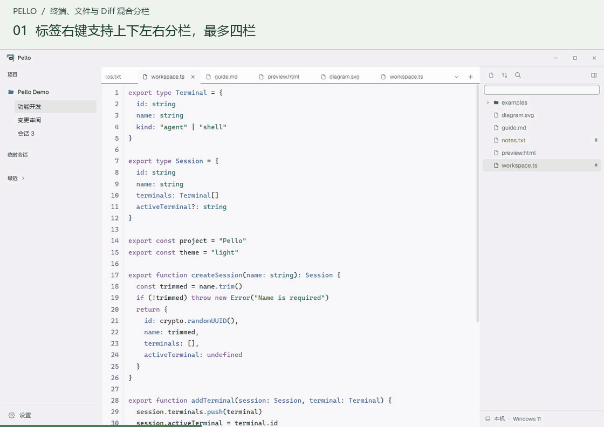

# Pello 图解使用指南

**从启动 Agent，到读文件、改代码、审阅变更。** 在一个 Windows 桌面工作区里完成日常任务。

从 [下载 Windows x64](https://github.com/FangYang970206/Pello/releases/latest) 开始。第一次使用，建议先跟着[启动第一个终端](Getting-Started)跑通 Shell，再换成自己的 Agent。

[逐步看静帧](https://github.com/FangYang970206/Pello/blob/main/assets/tutorials/STEPS.md#11-split) · [打开原尺寸动图](https://raw.githubusercontent.com/FangYang970206/Pello/main/assets/tutorials/11-split.gif)

## 选一条路线

| 你现在想做什么 | 从这里开始 |
| --- | --- |
| 第一次用，想先跑起来 | [安装并启动](Getting-Started) → [选择 Agent](Executors) |
| 同时推进几个任务 | [项目与会话](Sessions) → [混合分栏](Split-Workspace) |
| 阅读项目、定位问题 | [项目搜索](Project-Search) → [Markdown / HTML](Markdown-and-HTML) → [PDF / 图片](Media-Preview) |
| 改文件并检查结果 | [文件编辑](Files-and-Editing) → [查找替换](Find-and-Replace) → [Git 审阅](Git-Review) |
| 在另一台机器上工作 | [SSH、目录浏览与传输](SSH-and-Transfer) |
| 给 Agent 增加工具与方法 | [MCP / Skill](Agent-Resources) → [推荐 Skill](Skill-Discovery) |

## 全部功能课

在对应页面观看功能动图，或按步骤查看静帧。

- [先启动一个终端](Getting-Started)
- [用你熟悉的 Code Agent](Executors)
- [让每个任务保留自己的现场](Sessions)
- [临时想法，也有独立工作目录](Sessions)
- [终端、文件和 Diff，并排放好](Split-Workspace)
- [在终端输出里找到关键线索](Terminal)
- [文件各有标签，编辑各有记录](Files-and-Editing)
- [从项目里找，直接到源码里看](Project-Search)
- [找到它，改掉它，也能撤回来](Find-and-Replace)
- [把 Markdown 当文档读，也当文档写](Markdown-and-HTML)
- [网页预览，不离开工作区](Markdown-and-HTML)
- [需求图、PDF 和代码放在一起](Media-Preview)
- [看见变更，再决定保留什么](Git-Review)
- [把远程项目带进同一个工作区](SSH-and-Transfer)
- [MCP 与 Skill，按 Agent 管理](Agent-Resources)
- [浏览推荐 Skill](Skill-Discovery)
- [让界面适合你的阅读习惯](Appearance)
- [更新入口集中，工作数据随安装目录保存](Updates-and-Data)

## 怎么看这些动画

每段都有步骤字幕，关键区域自动聚焦放大，并停留供阅读。点击动图打开原尺寸；想暂停逐步看，请用[静帧教学版](https://github.com/FangYang970206/Pello/blob/main/assets/tutorials/STEPS.md)。所有画面来自实际应用与隔离样例；字幕和镜头是后期处理。

本文档按 2026-11-24 的当前代码整理，应用版本字段为 0.1.16。部分操作会受 Agent CLI、系统、权限与网络影响；教程不替代深度回归结果。开发版更新演示和本机回环 SSH 演示在相应页面明确标注。

[常见问题](Troubleshooting) · [开发与验证](Development) · [Windows 打包](Windows-Build) · [历史资料](Archive) · [反馈问题](https://github.com/FangYang970206/Pello/issues)
