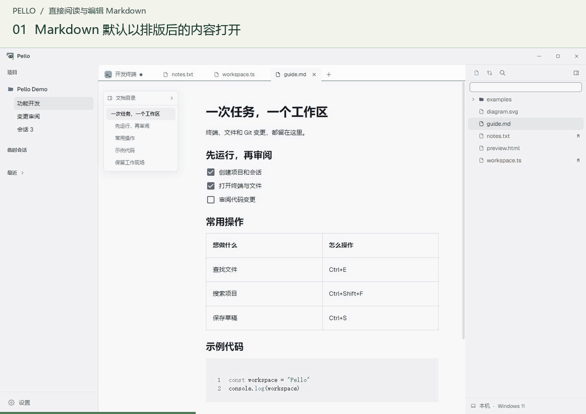
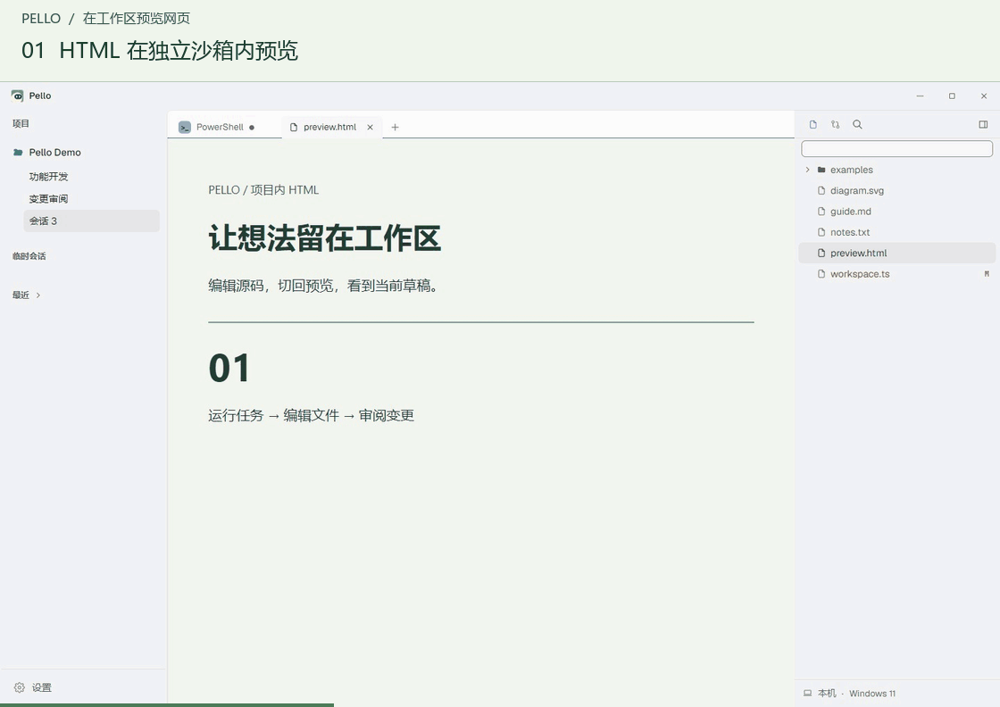

# 文档直接读，网页直接看

Markdown 以文档方式阅读与编辑，HTML 在沙箱内预览。

[逐步看静帧](https://github.com/FangYang970206/Pello/blob/main/assets/tutorials/STEPS.md#07-markdown) · [打开原尺寸动图](https://raw.githubusercontent.com/FangYang970206/Pello/main/assets/tutorials/07-markdown.gif)

## Markdown

打开 `.md` 文件默认进入渲染模式，打开动作不会重写磁盘文件。标题目录位于正文左侧，可跳转标题并显示当前位置；窄内容区可展开、收起。

- 直接在渲染模式编辑，Ctrl+F / Ctrl+H 查找替换并保留格式。
- 常见代码语言高亮随主题同步；代码块与长文档保留滚动定位。
- 正文右键切换源码，保存与元数据也在菜单里。
- Mermaid 在独立隔离进程中以严格模式渲染为图片；PlantUML 使用在线服务，会在界面标注。
- 项目内文档链接可导航；网页链接经主进程校验后在外部打开。

## HTML

[逐步看静帧](https://github.com/FangYang970206/Pello/blob/main/assets/tutorials/STEPS.md#08-html) · [打开原尺寸动图](https://raw.githubusercontent.com/FangYang970206/Pello/main/assets/tutorials/08-html.gif)

1. 打开 `.html` 文件，直接预览项目内页面，相对资源路径继续可用。
2. 正文右键进入源码，修改内容。
3. 切回预览，等待当前草稿的预览内容；这个动作不会隐式保存。

**你应该看到**：预览反映当前草稿，原文件要到保存时才改变。

HTML 使用 sandbox iframe 与受限本机服务，不能访问工作台 API 或顶层导航。预览可查找，替换需切源码；失败时有错误与重试。

Markdown、源码、HTML 和 Diff 都支持 Ctrl+滚轮局部缩放，范围 **50%–300%**，不改变用户的全局字号。

[功能目录](Home) · [日常工作路线](Workspace)
