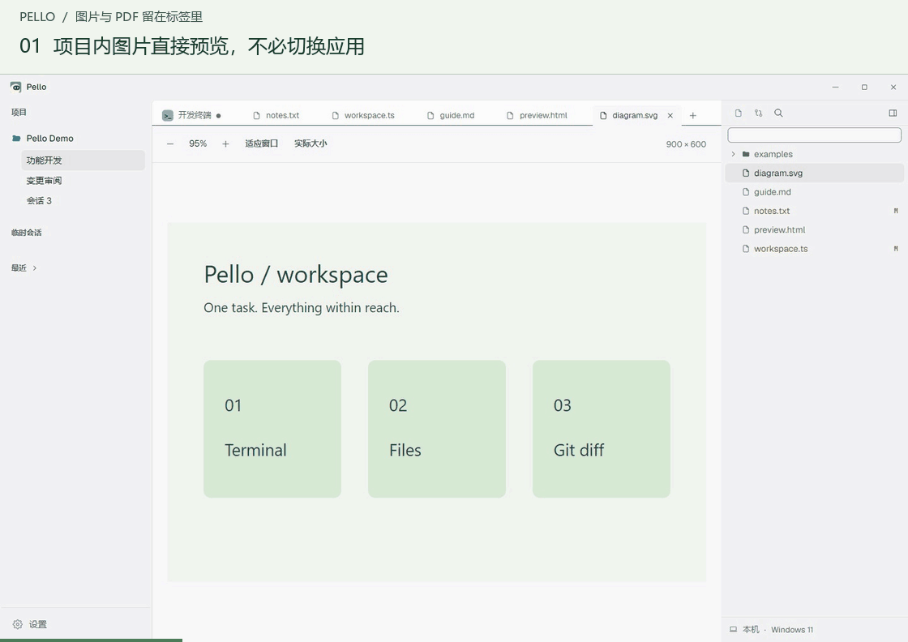

# 在标签内阅读 PDF 与图片

看需求文档、设计图和截图时，保留原来的终端与文件。

[逐步看静帧](https://github.com/FangYang970206/Pello/blob/main/assets/tutorials/STEPS.md#09-media) · [打开原尺寸动图](https://raw.githubusercontent.com/FangYang970206/Pello/main/assets/tutorials/09-media.gif)

## 图片

单击 PNG、JPEG、GIF、WebP、BMP、SVG、ICO 或 AVIF 文件打开只读预览。使用放大、缩小、实际大小与适应窗口；缩放范围 **25%–400%**。

## PDF

1. 打开 PDF，等待当前页绘制。
2. 用页码框、前后翻页按钮或键盘翻页。
3. 普通滚轮先滚动当前页，到页首/页尾继续滚动才翻页；Ctrl+滚轮只缩放。
4. Ctrl+F 可跨页查找并标出匹配。打开查找不会改变 PDF 的适应比例。

**你应该看到**：翻页只改变当前 PDF，其他标签与草稿保留。

本机与 SSH 媒体文件上限均为 **12 MB**。渲染资源随应用分发，不把 PDF 上传到在线转换服务，不执行 PDF/SVG 脚本；切换文件会取消旧加载或渲染。失败时可重试。

[功能目录](Home) · [日常工作路线](Workspace)
