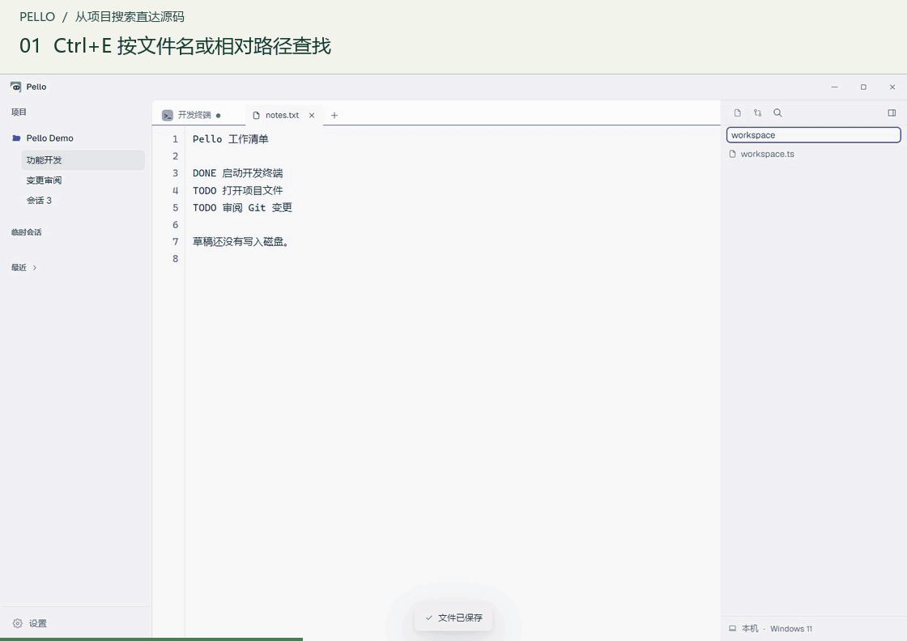

# 从项目搜索定位到源码

文件名和内容分开搜索，查询与结果按项目保留。

[逐步看静帧](https://github.com/FangYang970206/Pello/blob/main/assets/tutorials/STEPS.md#05-search) · [打开原尺寸动图](https://raw.githubusercontent.com/FangYang970206/Pello/main/assets/tutorials/05-search.gif)

## 找文件

按 **Ctrl+E** 打开文件页并聚焦名称搜索框，输入文件名或相对路径，如 `workspace` 或 `src/workspace`。清空搜索后回到原文件树滚动位置。

## 找内容

1. 按 **Ctrl+Shift+F**，输入要找的文字。
2. 需要时启用输入框右侧的大小写、全字匹配或正则按钮，悬停查看提示。
3. 在按文件分组的结果中点击高亮片段，直接在源码定位。结果列表保留，不必反复重新搜索。

**你应该看到**：右侧保留结果，当前栏打开匹配文件并滚到对应位置。已经打开的文件复用现有标签与草稿。

## 搜索范围与停止

本机与 SSH 都受真实项目边界约束，不跟随链接，始终跳过点目录并遵循项目忽略规则。后台跳过二进制、非 UTF-8 和超过 2 MB 的文件；读取失败单独提示。达到 **2000 个匹配** 时会提示缩小范围。

结果分批返回，可停止或重新搜索；改词、切项目/视图或离开面板会取消旧任务。正则无效会明确报错，执行有时限，避免复杂表达式长时间占用进程。只找当前文档请用 [Ctrl+F](Find-and-Replace)。

[功能目录](Home) · [日常工作路线](Workspace)
