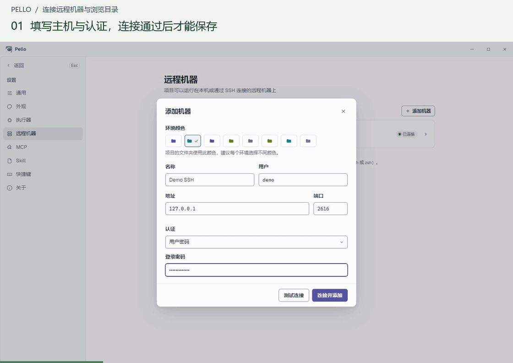

# 连接远程项目，浏览与编辑文件

终端、文件、搜索与 Git 都使用项目对应的远程环境。

[逐步看静帧](https://github.com/FangYang970206/Pello/blob/main/assets/tutorials/STEPS.md#18-ssh) · [打开原尺寸动图](https://raw.githubusercontent.com/FangYang970206/Pello/main/assets/tutorials/18-ssh.gif)

## 连接一台机器

1. 「设置 → 远程机器」添加主机，填写地址、端口与用户名。
2. 选择密钥、SSH Agent 或密码认证，测试连接。只有连接成功才能保存；失败保留输入与错误。
3. 新建项目时选这台机器，点击「浏览」选择远程项目目录。

密码只在主进程使用系统加密保存；连接会校验主机指纹。指纹变化时先核对机器身份，不要用删除安全检查来绕过错误。

## 目录选择器怎么用

单击目录选中，双击或 Enter 进入；顶部提供返回、前进、上一级、主目录、可编辑路径和面包屑，也可以筛选当前子目录。底部确认所选目录。加载失败时不能确认，Esc 只关选择器并返回原项目表单。

动图使用回环地址上的隔离 SSH 服务，真实认证并执行 PowerShell 目录查询；示例不代表访问某台生产服务器。

## 上传、下载与同名处理

在文件树右键使用上传、下载或另存为。远程上传同名文件直接覆盖，同名文件夹**整体替换**，旧目录独有内容也会被移除；遇到未保存草稿仍会要求确认。

上传先写临时位置，再检查版本并发布。界面单行显示「上传中」与 × 取消，发布替换阶段暂停取消；成功显示「上传成功」，2 秒后消失。失败保留错误、重试与关闭操作；旧备份清理失败时提示保留位置。

## 在远程终端里继续 ssh

受托管的 Linux/Bash 终端内普通 `ssh` 登录下一台机器后，文件、搜索和 Git 可跟随终端报告的当前用户、机器与目录，无需另配跳板。复用已认证的 ControlMaster；退出一层后停用该层目标。连接失败会报错，不会偷偷退回初始机器操作同名文件。

这个跟随能力有 Shell/SSH 环境条件，并非所有平台和任意嵌套终端都适用。远程文件标签与草稿绑定打开时的目标，不会因后来切换机器而串用。

[功能目录](Home) · [日常工作路线](Workspace)
