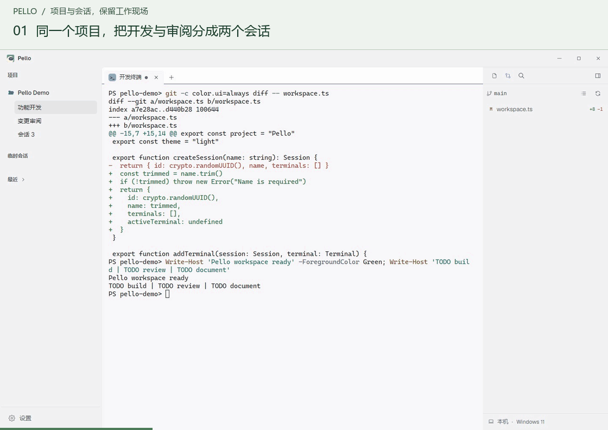
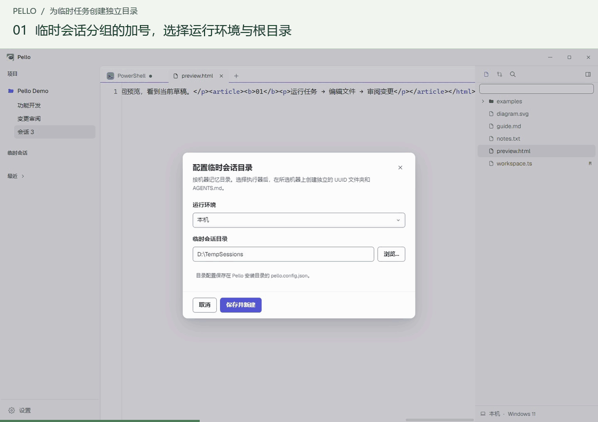

# 按任务整理会话，切换时保留现场

项目是目录，会话是一项任务，终端是任务里运行的工具。

[逐步看静帧](https://github.com/FangYang970206/Pello/blob/main/assets/tutorials/STEPS.md#02-sessions) · [打开原尺寸动图](https://raw.githubusercontent.com/FangYang970206/Pello/main/assets/tutorials/02-sessions.gif)

## 日常操作

1. 项目行的 ＋ 新建会话，选择执行器后创建首个终端。
2. 标签旁的 ＋ 给当前会话增加终端。
3. 单击另一个会话，再切回来。原来的终端输出和实例继续保留。

项目菜单提供置顶、重命名和路径操作。项目 F2 改名，双击展开/收起；会话和终端标签支持双击、F2 或右键改名。改名只更新显示名称，不移动目录。

「最近」默认折叠，仅列出仍打开的 Code Agent，可筛选运行中或空闲中；纯 Shell 与已退出的 Agent 不在其中。点击条目会定位到对应项目与会话。

## 临时任务不必建正式项目

[逐步看静帧](https://github.com/FangYang970206/Pello/blob/main/assets/tutorials/STEPS.md#16-temporary) · [打开原尺寸动图](https://raw.githubusercontent.com/FangYang970206/Pello/main/assets/tutorials/16-temporary.gif)

1. 悬停「临时会话」标题，点 ＋。
2. 选择本机或已保存的 SSH 机器。首次选择根目录，后续按机器记忆；Windows 默认建议 `D:\TempSessions`。
3. 保存并选择执行器。主进程在所选环境中创建 UUID 子目录与 `AGENTS.md`，并由 `CLAUDE.md` 导入同一约束。

**你应该看到**：侧栏出现临时会话，终端当前目录为新建的独立目录。取消执行器选择不会创建任务子目录。关闭会话不会自动删除任务目录。

## 退出后恢复什么

开启恢复后，重新启动会恢复本机与远程会话、最后项目与可视终端历史，并自动续接各终端自己的 Agent 原生对话。历史与新进程之间有分隔线。失败时保留标签、记录与错误，右键可重新连接。

CLI 升级、认证失效、网络断开或原生记录丢失可能导致恢复失败。旧会话缺少准确 ID 时需要唯一证据匹配，不能确定就报错，不猜测最近会话。显式关闭终端标签会删除对应历史；终端快捷键关闭及 Agent 关闭会要求确认。

[功能目录](Home) · [日常工作路线](Workspace)
