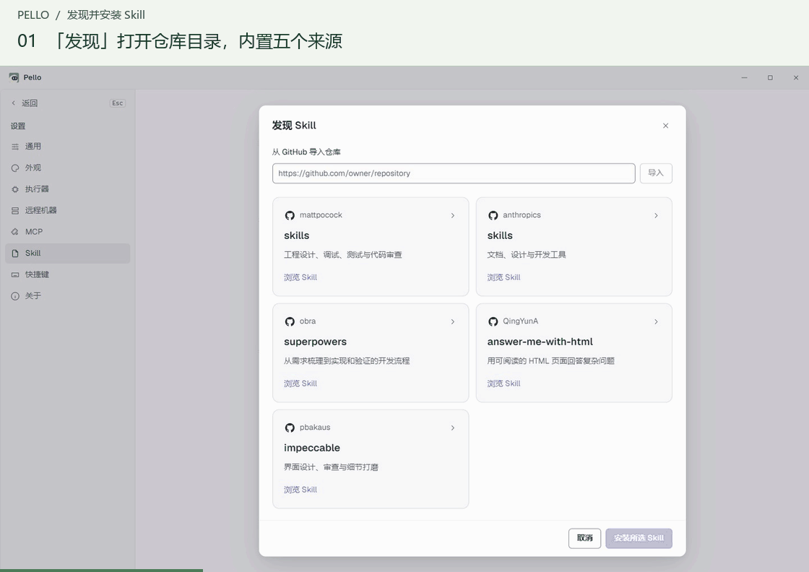

# 发现、读懂、安装一个 Skill

先看完整说明，再选择安装内容和目标 Agent。

[逐步看静帧](https://github.com/FangYang970206/Pello/blob/main/assets/tutorials/STEPS.md#13-discovery) · [打开原尺寸动图](https://raw.githubusercontent.com/FangYang970206/Pello/main/assets/tutorials/13-discovery.gif)

## 跟着做

1. 打开「设置 → Skill → 发现」。点击内置仓库卡片，或输入 GitHub HTTPS 仓库 / tree 目录链接。
2. 等待扫描，搜索名称或说明。点击 Skill 名称可阅读完整文档。
3. 取消全选后勾选需要的 Skill，或保持全选；选择目标 Agent。
4. 点击「安装所选 Skill」，查看逐项结果。已导入的仓库会保存，重启仍可用。

**你应该看到**：安装后回到列表，资源写入所选 Agent 的原生发现目录。演示实际从 `mattpocock/skills` 选择并安装 `tdd` 到隔离配置。

## 扫描与安装规则

扫描固定到某个提交，说明预览和安装复用同一份快照，避免预览后内容变动。正式目录排除样例和重复工具副本；同名不覆盖。不执行仓库脚本，也不重写上游 `SKILL.md`。

下载与解压保留 **32 MB / 10000 文件**限制和路径边界检查。离开或取消会清理下载，失败保留选择并可重试。安装完成后，当前 Agent 是否立即发现资源取决于其原生加载方式。

[功能目录](Home) · [日常工作路线](Workspace)
