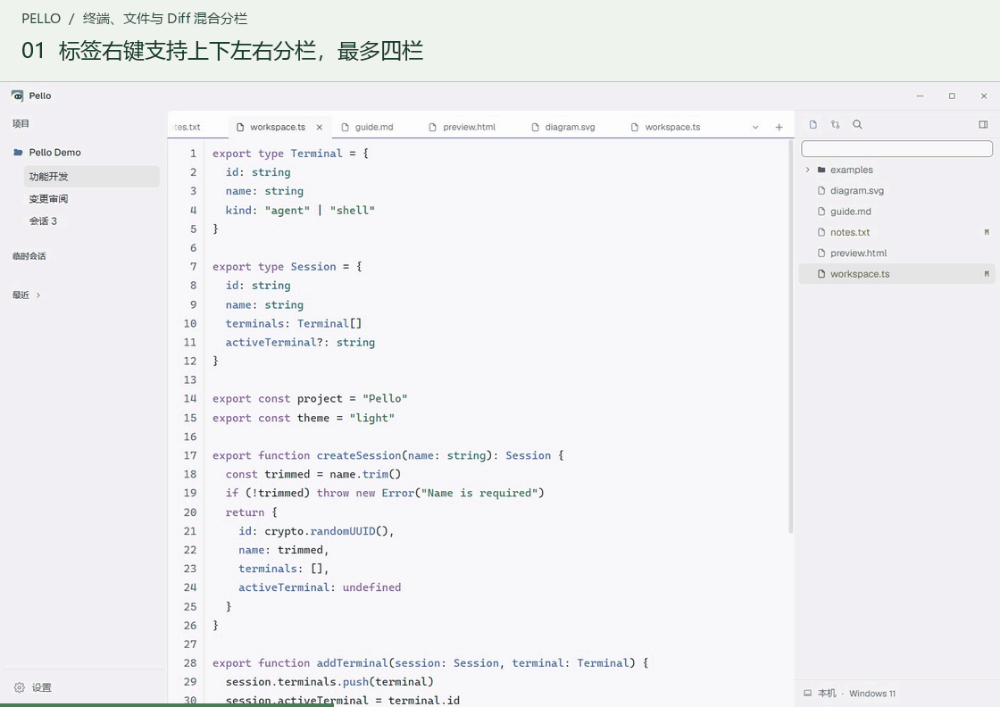

# 把终端、文件与 Diff 放在一起

每栏拥有自己的标签和当前内容，最多同时四栏。

[逐步看静帧](https://github.com/FangYang970206/Pello/blob/main/assets/tutorials/STEPS.md#11-split) · [打开原尺寸动图](https://raw.githubusercontent.com/FangYang970206/Pello/main/assets/tutorials/11-split.gif)

## 跟着做

1. 右键一个文件、Diff 或终端标签，选择向左、右、上或下分栏。键盘可聚焦标签后按 Shift+F10。
2. 文件或 Diff 分栏创建同一内容的独立视图。在另一栏点终端标签，就得到「终端 + 文件」组合。
3. 拖动标签到另一栏，移动归属；终端不会因移动而重新启动。
4. 菜单选择「撤销分栏（合并）」，所有标签汇总到同一栏，不会关闭其他终端。

**你应该看到**：两栏内容可分别切换，文件草稿与撤销共享，终端输出保留。

## 操作边界

- 打开文件或新建终端进入当前栏。同一文件可以在不同栏各有视图。
- 关闭活动标签优先选同栏的其他标签，空栏自动移除并填满空间。
- 文件、终端和 Diff 的查找只作用于当前栏。
- 标签栏内滚轮切换相邻标签，首尾不循环；下箭头打开本栏全部标签列表，Esc 关闭并返回按钮。
- 侧栏与文件面板可拖动边缘调宽，也可用分隔条的键盘操作。

[功能目录](Home) · [日常工作路线](Workspace)
