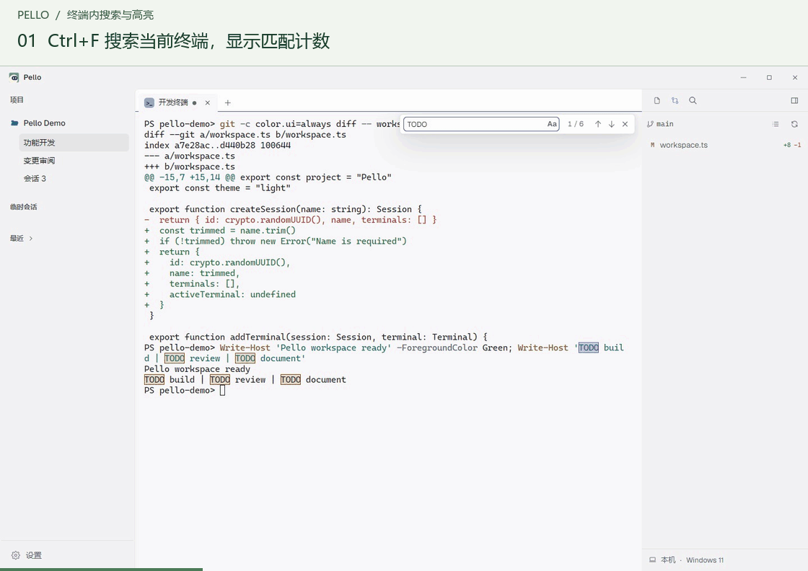

# 在输出中查找、选择与标记

大量日志里，先找到线索，再把关键内容留在眼前。

[逐步看静帧](https://github.com/FangYang970206/Pello/blob/main/assets/tutorials/STEPS.md#03-terminal) · [打开原尺寸动图](https://raw.githubusercontent.com/FangYang970206/Pello/main/assets/tutorials/03-terminal.gif)

## 查找当前终端

1. 点击要搜索的终端，按 **Ctrl+F**。
2. 输入文字，查看匹配计数，可切换大小写并前后导航。
3. 按 **Esc** 关闭搜索，焦点回到原终端。快捷键不会把控制字节发给正在运行的程序。

## 六色高亮

1. 鼠标拖选关键文字，松开鼠标后保留选区。
2. 正文右键，选择一颗色球。多处相同文字一起高亮；不同文字可用不同颜色。
3. 再次选中同样文字可换色，菜单里的「清除高亮」清除当前终端的标记。

右键还有复制、粘贴、全选与搜索；键盘可用 Shift+F10 或菜单键打开菜单，再用方向键选择。未选中文字时色球禁用。若 TUI 启用了鼠标协议，普通拖动仍用于选择；**Alt+鼠标** 保留程序原生交互。

粘贴可用 Ctrl+V / Ctrl+Shift+V，经 xterm 的括号粘贴协议送入程序。终端正文菜单专注文字操作；分栏和标签重命名在标签菜单里。

[功能目录](Home) · [日常工作路线](Workspace)
