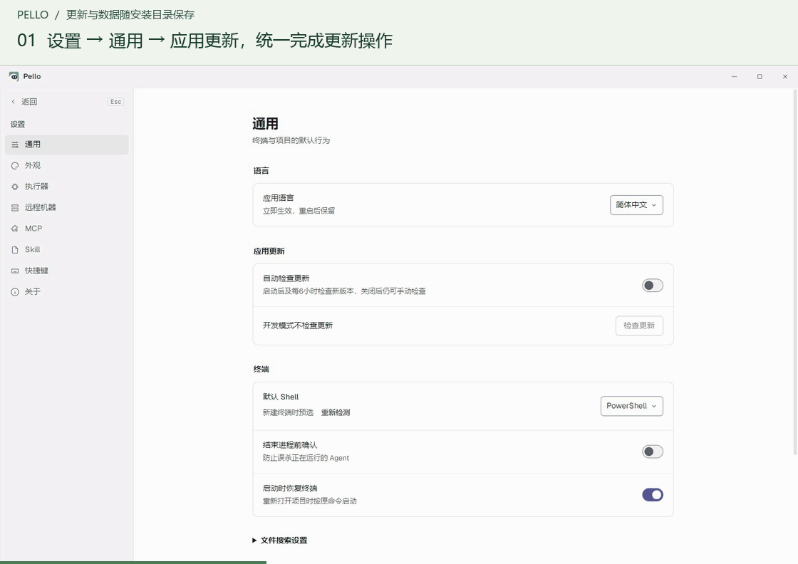

# 更新应用，保留工作数据

所有更新操作集中在「设置 → 通用 → 应用更新」。

[逐步看静帧](https://github.com/FangYang970206/Pello/blob/main/assets/tutorials/STEPS.md#15-updates) · [打开原尺寸动图](https://raw.githubusercontent.com/FangYang970206/Pello/main/assets/tutorials/15-updates.gif)

## 更新一步步做

1. 打开通用设置，查看「应用更新」。自动检查默认开启，启动后及每 6 小时检查稳定版。
2. 可以关闭自动检查，设置重启后保留；关闭后仍可手动检查。
3. 发现版本后由你点击下载；下载进度和失败重试都在此处。
4. 下载完成后点击「安装并重启」。安装前复用草稿确认与终端历史保存，再清理进程。取消确认不会结束终端。

**完成标志**：重启后在「关于」看到新版本，恢复的终端有预期历史内容。

动图来自当前开发版，真实显示「开发模式不检查更新」，只演示设置入口与开关。下载、安装和自动重启应在发行包中执行；这段动图不是升级验证记录。

## 数据放在哪里

| 位置 | 内容 |
| --- | --- |
| 安装目录 `data/` | 配置、会话历史、缓存、日志、更新下载 |
| 安装目录 `pello.config.json` | 安装级配置，包括临时会话根目录 |
| 你自己的项目目录 | 项目文件、Git 仓库与任务输出 |

安装目录必须可写，不可写时明确报错，不回退用户目录。旧版 `%APPDATA%\agent-workbench` 首次启动完整复制迁移，成功前不发布半成品，不覆盖已有安装数据，旧目录保留。

## 备份、升级与卸载

退出 Pello 后复制 `data/` 和 `pello.config.json`，项目文件另行备份。Agent 自己的认证与原生配置目录不等于 Pello 数据，按相应 CLI 说明处理。

安装版在安装目录提供 `Uninstall Pello.exe`，也可用 Windows 应用列表卸载。升级与卸载保留数据。ZIP 解压版需保留同目录资源，手动替换程序时保留数据；也可从 [Releases](https://github.com/FangYang970206/Pello/releases/latest) 下载新版本。

[功能目录](Home) · [日常工作路线](Workspace)
